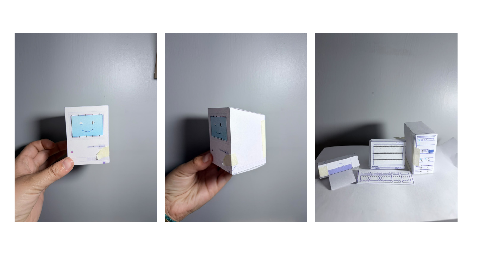
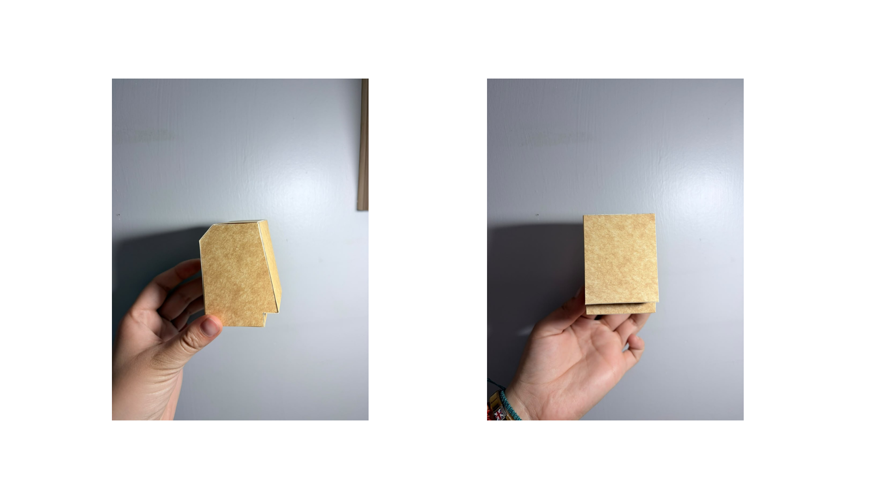
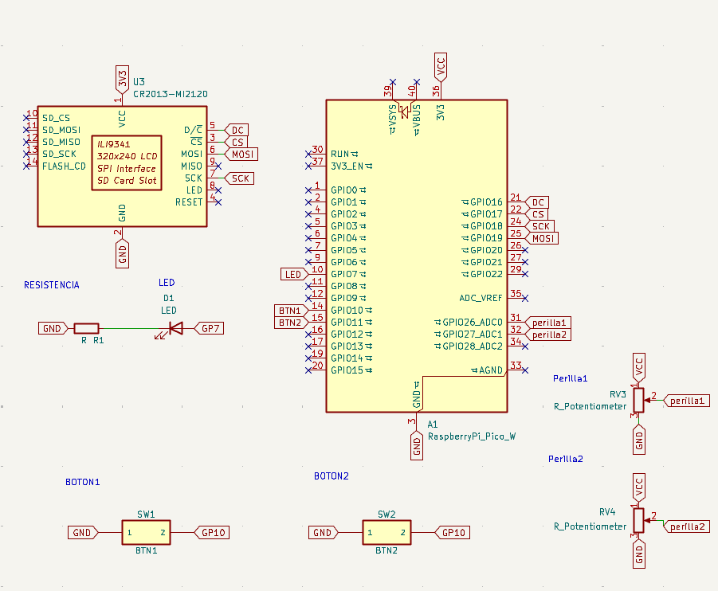

<p align="center">
  
  
</p>
<p align="center">
  
  
</p>

<h2 align="center">Remanencia</h2>

## Integrantes

- ***Anais Marschhausen*** @anaisbmg
- ***Antonia Loch***  @antoloch
- ***Hugo Montoya*** @hugomontoya
- ***Carla Núñez*** @ccarlabelenn

## Sobre el proyecto

Este proyecto toma como referente el Apple Macintosh de 1984, recuperando su lenguaje visual basado en ventanas, carpetas, íconos y una interfaz monocromática de píxeles. A partir de esta estética, proponemos un escritorio digital interactivo que permite explorar carpetas que contienen frases relacionadas con recuerdos, emociones y experiencias personales de una manera intuitiva y cercana.

El proyecto busca reflexionar sobre cómo la tecnología, además de procesar información y facilitar tareas cotidianas, puede convertirse en un medio para preservar algo profundamente humano: los recuerdos, los vínculos y las experiencias compartidas.

## Referente Apple Mac

El Macintosh 128K, lanzado en enero de 1984, destacó por incorporar una interfaz gráfica de usuario basada en ventanas, íconos y menús, junto con el uso de un ratón. Su pantalla monocromática de 1 bit representaba las imágenes mediante píxeles blancos y negros.
La tipografía y gran parte de la iconografía original fueron diseñadas por Susan Kare, cuyo trabajo contribuyó a que la informática resultara más accesible y comprensible para usuarios sin conocimientos técnicos.
Nuestro proyecto retoma este lenguaje visual y lo combina con un anacronismo consciente: ventanas simultáneas que funcionan como espacios de exploración y encuentro con recuerdos personales.

<p align="center">
  
  <br>
  <em>Figura 1. Macintosh 128K. Imagen obtenida de Wikipedia:
  https://es.wikipedia.org/wiki/Macintosh_128K</em>
</p>

## Remanencia

La remanencia es aquello que permanece después de que algo ha pasado. El nombre representa la forma en que los recuerdos siguen existiendo tanto en nuestra memoria como en los dispositivos digitales que utilizamos para almacenarlos.
El proyecto busca explorar esa permanencia mediante una interfaz inspirada en los primeros computadores personales, permitiendo navegar recuerdos personales almacenados en un entorno digital.

## Concepto

La propuesta consiste en un escritorio digital compuesto por cuatro carpetas que contienen imágenes personales simplificadas a frame. Mediante botones y perillas físicas, el usuario puede desplazarse por la pantalla, seleccionar carpetas y explorar sus fotografías.
La interacción busca ser sencilla e intuitiva, generando una experiencia íntima que acerque la tecnología a las personas.

- **Escritorio:** inspirado en la interfaz gráfica del Macintosh de 1984.
- **Carpetas:** una cuadrícula de 2 × 2 con cuatro carpetas que contienen imágenes.
- **Ventanas:** elementos visuales que permiten mostrar el contenido de las carpetas.
- **Pantalla:** muestra el escritorio, las fotografías y las interacciones del usuario.
- **Estética:** píxeles, íconos y gráficos monocromáticos.

## Cuatro carpetas

1. **Personas**: contiene frases relacionadas con los vínculos afectivos, las personas importantes y las huellas que dejan en nuestra vida.

2. **Lugares**: contiene frases que evocan espacios significativos, lugares que recordamos y experiencias asociadas a ellos.

3. **Momentos**: contiene frases sobre instantes cotidianos, experiencias compartidas y situaciones que adquieren significado con el paso del tiempo.

4. **Objetos**: contiene frases relacionadas con objetos que poseen un significado emocional por las historias y experiencias que representan.

## Interacción

- **Perilla 1 (eje Y):** movimiento vertical en la pantalla
- **Perilla 2 (eje X):** movimiento horizontal, simulando el movimiento de un mouse
- **Botón 1:** seleccionar, abrir una carpeta y volver al escritorio
- **Botón 2:** controlar acciones relacionadas con la reproducción y visualización de imágenes

parte de nuestra clase:

- **Sin presionar:** estado 0.
- **Presionar durante 1 segundo:** abrir la carpeta seleccionada.
- **Presionar 2 veces:** avanzar a la siguiente fotografía.
- **Presionar 3 veces:** activar un carrusel de fotografías.
- **Mantener presionado durante 5 segundos:** volver al escritorio, independientemente de la posición de las perillas.

Al abrir una carpeta, se muestra inicialmente su primera imagen. El usuario puede avanzar entre fotografías y activar su reproducción secuencial. Una pulsación prolongada permite regresar al escritorio y explorar otra carpeta.

# Relato de uso de la máquina

Al encender el dispositivo, el usuario observa un escritorio digital con cuatro carpetas.
Utilizando la perilla horizontal y la perilla vertical puede desplazar el cursor sobre la pantalla hasta posicionarse sobre la carpeta que desea explorar.
Una vez seleccionada, mantiene presionado el botón principal durante un segundo para abrirla.
Al abrir una carpeta, se muestra una fotografía representativa. El usuario puede avanzar entre imágenes o activar una reproducción automática mediante distintas combinaciones de pulsaciones.
Cuando desea regresar al menú principal, puede mantener presionado el botón durante cinco segundos para volver al escritorio y explorar nuevas carpetas.
La experiencia busca recrear la sensación de recorrer recuerdos digitales mediante una interfaz inspirada en los primeros computadores personales.

## Desarrollo técnico

El proyecto contempla la programación de clases para botones y perillas, responsables de traducir las acciones físicas del usuario en interacciones digitales.
La clase Boton considera cinco variables y cinco funciones para gestionar el estado del botón, detectar las pulsaciones, medir su duración y ejecutar acciones según el contexto de uso.
Las perillas permiten controlar la posición del cursor en los ejes horizontal y vertical, mientras que la pantalla representa visualmente las acciones realizadas.
Se considera el uso de una Raspberry Pi como plataforma de procesamiento y almacenamiento, junto con una pantalla y controles físicos. Las imágenes se organizan en carpetas para facilitar su navegación y visualización.

## Diagrama de flujo


## Bom

| Componentes | Cantidad | Precio unitario | Link |
| --- | --- | --- | --- |
| Raspberry Pi Pico 2W | 1 | $14.990 | <https://raspberrypi.cl/products/raspberry-pi-pico-2-w-con-headers> |
| Botón pulsador | 2 | $100 | <https://afel.cl/products/boton-tactil-tapa-12x12x7-3-interruptor?_pos=4&_sid=f5c2aac0d&_ss=r> |
| Potenciómetro b100k | 2 | $495 | <https://altronics.cl/potenciometro-lineal-100k-b100k> |
| LED | 1 | $100 | <https://afel.cl/products/kit-50-diodos-leds-de-5mm-ultrabrillantes> |
| Resistencia 220 Ω | 2 | $495 | <https://altronics.cl/potenciometro-lineal-100k-b100k> |
| Pantalla ILI9341 | 1 | $16.990 | <https://afel.cl/products/shield-tft-touch-3-2-ili9341?srsltid=AYCX9vLf24U_AsYjwifPUWpld3K7FYkukGNdyBM3ej3P2EYb3arjNnl9> |
| Protoboard | 1 | 1.500 | <https://afel.cl/products/mini-protoboard-400-puntos?_pos=1&_sid=a63a98843&_ss=r> |

## Pseudocódigo del rol de los componentes

**inicio**

```cpp
disponible pantalla
disponible perilla x
disponible perilla y
disponible botón 1
disponible botón 2

//debe estar visualizando la pantalla con las cuatro carpetas

estado = activo
```

**navegar**

```cpp
posición de perilla x
posición de perilla y

//si estamos ubicados en el escritorio podemos movernos vertical u horizontal
//gracias a las perillas

humanamente decidir sobre qué carpeta me quiero posicionar

seguro que quieres seleccionar esa carpeta? = presiona el botón 1 durante 1 segundo

            Seleccionar carpeta
            Abrir carpeta
            Mostrar primera fotografía de la carpeta
```

**carpeta**

```cpp
si la carpeta está abierta podemos continuar: true

nos mostrará directamente un frame representativo de la carpeta

    SI botón 2 se presiona 2 veces
        Avanzará a la siguiente fotografía
 //para poder
        Mostrar nueva fotografía

    SI botón 2 se presiona 3 veces
        Activar carrusel de fotografías
//para poder
        Reproducir fotografías automáticamente

    SI botón 2 se mantiene presionado durante 5 segundos
        Detener carrusel
 //para poder
        Volver al escritorio digital
//estará listo para poder volver a navegar en nuestros recuerdos de escritorio
```

**loop**

```cpp
si está encendido

podemos volver a navegar
ver diferentes carpetas
ver frames
ver carrusel

Fin y haz loop como quieras:)
```

## Carcasa

La propuesta considera una carcasa inspirada en el Macintosh 1984.
Su diseño busca representar visualmente el computador histórico mientras integra pantalla y controles físicos compuestos por dos perillas y dos botones.
La forma general toma como referencia la estética compacta del Macintosh, reinterpretándola como un objeto destinado a la exploración de recuerdos digitales.




## Referentes

Acá logramos observar el Macintosh por dentro, descubriendo los componentes y la arquitectura que hicieron posible su funcionamiento.

<p align="center">
  
  <br>
  <em>Interior del Macintosh original.</em>
</p>

> **Fuente:** [iFixit – Evertiq](https://evertiq.com/news/33666) · 24 de enero de 2014.

Susan Kare fue la diseñadora gráfica responsable de crear gran parte de los elementos visuales de la interfaz del Apple Macintosh. Su trabajo incluyó íconos, tipografías y símbolos que ayudaron a construir un lenguaje gráfico simple, reconocible y cercano para los usuarios.

<p align="center">
  
  <br>
  <em>Íconos creados por Susan Kare para el Macintosh.</em>
</p>

> **Fuente:** [99% Invisible – Designed with Kare](https://99percentinvisible.org/article/designed-with-kare-influential-macintosh-graphics-of-early-apple-computers/)

# Problemas y decisiones durante el proceso

El viernes 30 de octubre nos quedamos trabajando hasta tarde en la universidad para intentar finalizar el proyecto.
Durante gran parte de la tarde, Sebastián Sáez nos ayudó revisando el código y orientándonos sobre cómo implementarlo utilizando la Raspberry Pi Pico 2W.
Hasta ese momento ya contábamos con una versión funcional del código y nuestro objetivo era transferirlo a la placa física para comenzar las pruebas finales.
Alrededor de las 18:00 horas, Sebastián detectó un problema importante. El código había sido desarrollado considerando una configuración distinta a la del hardware que teníamos físicamente. Las placas utilizadas durante el proceso no correspondían exactamente a la misma configuración, generando incompatibilidades.
Al descubrir esta situación entendimos que gran parte del trabajo realizado no podía trasladarse directamente a la Raspberry Pi Pico 2W. Además, adaptar el proyecto y traspasar correctamente el código al entorno de Visual Studio Code resultó mucho más complejo de lo esperado.
En ese momento nos encontrábamos cansados y preocupados, ya que habíamos dedicado varias horas de trabajo antes de detectar el problema.
Después de analizar distintas alternativas, decidimos presentar el funcionamiento mediante una simulación en Wokwi, lo que nos permitía demostrar la lógica de navegación, las interacciones y el comportamiento esperado del sistema.
Finalmente, también se tomó la decisión de construir una carcasa representativa para la entrega final. Aunque no incluiría los componentes electrónicos funcionando en su interior, permitiría mostrar la propuesta formal, la experiencia de uso y la referencia al Macintosh original.

# Prompts utilizados

Lista de referencias:
Anthropic. (2026). Claude Sonnet 5.5 [Modelo de lenguaje de gran tamaño]. <https://claude.ai>

Recomendación de APA para IA generativa: describir en el texto qué se le preguntó y adjuntar la conversación como apéndice (ver sección 3). Ejemplo:

Al pedirle a Claude que generara un esquemático de KiCad a partir del archivo JSON de Wokwi, el modelo produjo un archivo .kicad_sch y una tabla de conexiones (Anthropic, 2026). Las preguntas completas y las respuestas se incluyen en el Apéndice A.

IEEE

[1] Anthropic, "Claude Sonnet 5.5," modelo de lenguaje de gran tamaño, conversación personal con [Tu Nombre], 2 nov. 2026. [En línea]. Disponible: <https://claude.ai>

MLA 9.ª edición

"Explícame cómo funciona este código Config.h" y otras consultas. Claude Sonnet 5.5, Anthropic, 2 nov. 2026, claude.ai.

Estilo libre / nota al pie

Conversación con Claude Sonnet 5.5 (Anthropic), 2 de noviembre de 2026, claude.ai. Consultas sobre conversión de Wokwi a KiCad y explicación de Config.h.

1. Resumen de la conversación
N.º Consulta del usuario Resultado de Claude
1 Generar un esquemático para KiCad a partir de un JSON de Wokwi, lo más ordenado posible. Archivo pico_wokwi.kicad_sch generado con script; tabla de conexiones (3V3, GND, GP7, GP10, GP11, GP16–GP19, GP26, GP27); advertencias sobre R2 suelta, pull-up interno en botones y pines de la pantalla sin conectar (RST, LED, MISO).
2 Explicar el código de Config.h. Explicación de include guard, stdint.h, namespace, constexpr, tabla de pines y tiempos, ejemplo de uso.
3 Crear un markdown para citar la conversación como referencia de un trabajo. Este documento.
2. Apéndice A: transcripción de las consultas (prompts)
Prompt 1

Me puedes hacer un esquemático en formato código para que pueda copiar y pegar directamente a KiCad, a partir del código JSON que te voy a mandar que fue hecho en Wokwi, quiero un esquemático de las conexiones que hay en este proyecto lo más ordenado posible, si es que no se puede hacer a través de darle código al KiCad, dime qué otra opción habría

Adjunto en el mensaje: archivo diagram.json de Wokwi (versión 1, editor wokwi) con las partes: breadboard, Raspberry Pi Pico, LED rojo, resistencias de 220 Ω y 10 kΩ, dos pulsadores de 6 mm, dos potenciómetros y pantalla ILI9341, más la lista de conexiones. [Agrega aquí el JSON completo si tu trabajo lo requiere.]

Respuesta (resumen): Claude indicó que KiCad guarda esquemáticos como texto y generó un archivo .kicad_sch completo (símbolos genéricos y etiquetas de red). Entregó la tabla de conexiones y señaló: R2 de 10 kΩ sin conectar, pulsadores sin pull-up externo (usar pull-up interno), RST/LED/MISO de la pantalla sin conectar y que GP0/GP1 del monitor serie son solo del simulador.

Prompt 2

que es este codigo explicame como funciona

Adjunto en el mensaje: archivo Config.h (C++ para Raspberry Pi Pico) con include guard, namespace Config, constantes constexpr de pines (GP26, GP27, GP10, GP11, GP7; SPI: GP18, GP19, GP17, GP16) y tiempos (TIEMPO_ARRANQUE = 1500, TIEMPO_CARRUSEL = 2000, FOTOS_POR_CARPETA = 4). [Agrega aquí el código completo si tu trabajo lo requiere.]

Respuesta (resumen): Claude explicó que es un archivo de cabecera solo con constantes; detalló el include guard, stdint.h, el namespace y constexpr; presentó tablas de pines y tiempos y un ejemplo de uso (Config::PIN_LED, Config::TIEMPO_ARRANQUE).

# Esquemáticos


# Esquemático



## Bibliografía

- Wikipedia. Macintosh 128K. Wikipedia, la enciclopedia libre.<https://es.wikipedia.org/wiki/Macintosh_128K>

- Staff Editor. (2014, 24 de enero). *Blast from the past: Mac 128K Teardown*. Evertiq. <https://evertiq.com/news/33666>

- Kohlstedt, K. (2018, 6 de julio). *Designed with Kare: Influential graphics of Apple’s early Macintosh computers*. 99% Invisible. <https://99percentinvisible.org/article/designed-with-kare-influential-macintosh-graphics-of-early-apple-computers/>
