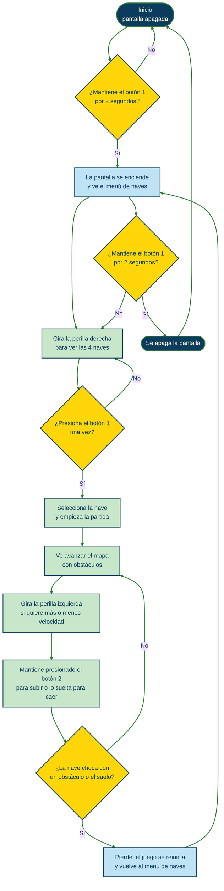
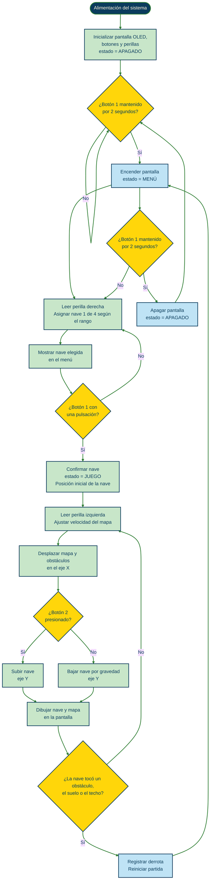
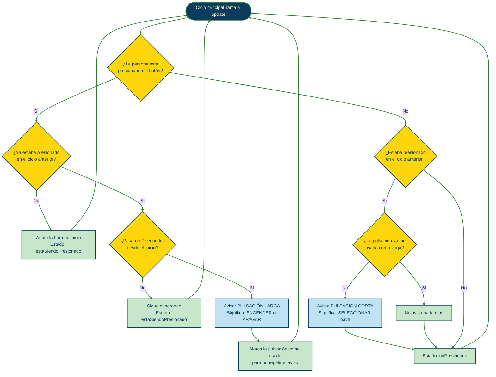
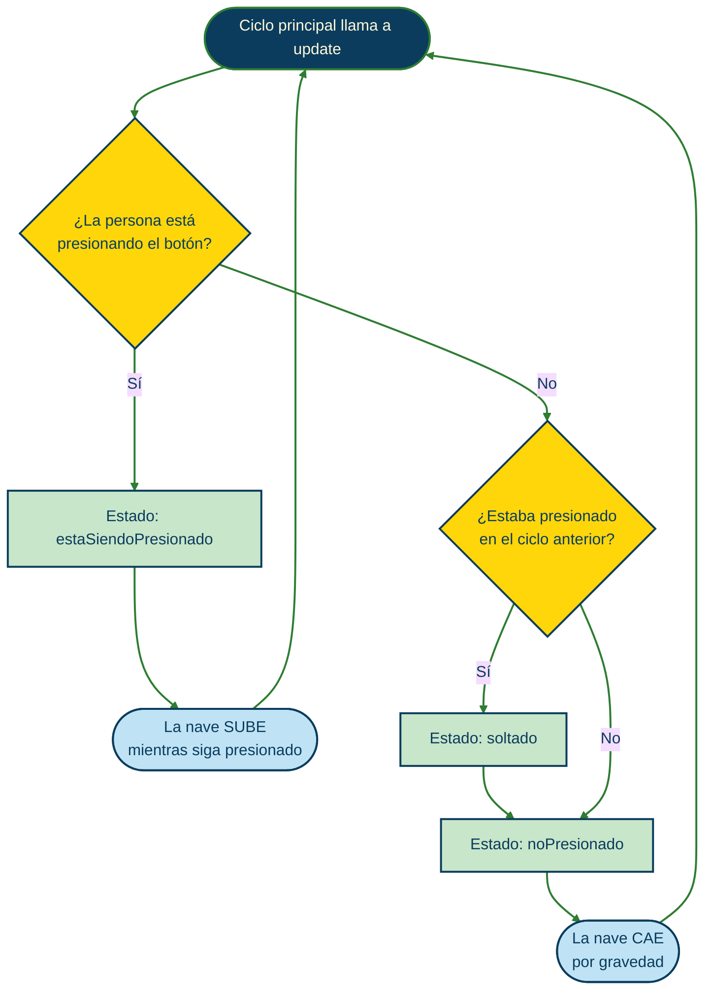
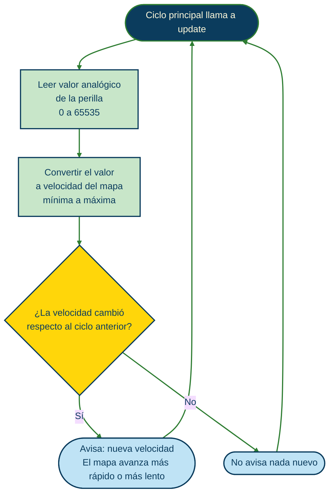
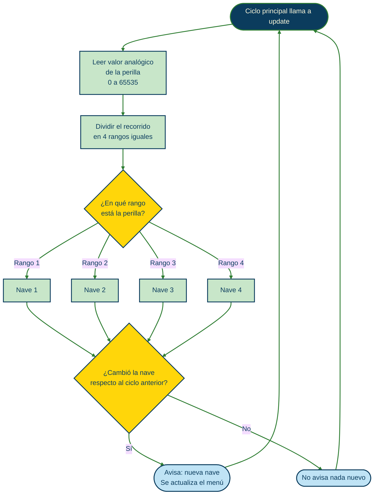
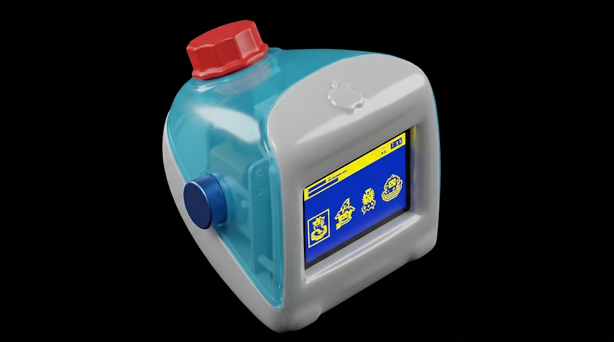
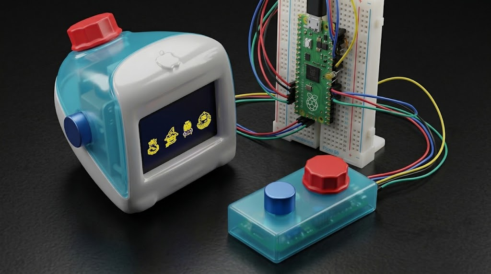

# Proyecto 2 

**Integrantes:**


- Belén Castillo / [bombobby](https://github.com/bombobby) 


- Martina Fernandez / [pumpkinguurl](https://github.com/pumpkinguurl) 

- Maite Villarroel / [maiteev](https://github.com/maiteev) 


- Nacha Zamudio / [nachazamudio](https://github.com/nachazamudio)


# Space Float 

Space Float es un juego de nave, la cual hay que mantener volando la nave por el mayor tiempo que pueda sin chocar con obstáculos ni caer en el espacio. Tendrá 2 botones y 2 perillas para su uso, el primer botón es seleccionador de personajes, al mantenerse presionado durante 2 segundos, prende y apaga el juego, el segundo botón volador es el que sirve para mantener la nave volando, ya que al presionarlo la nave sube hasta que el botón se suelta y la nave comienza a caer, por lo que se debe intercalar el presionar y soltar para evitar que la nave caiga. Las perillas manejan dos aspectos distintos, la perilla derecha es una selección de diferentes naves para que el usuario escoja, son cuatro naves: 1-calabaza, 2-chango, 3-gato alien y 4-vaca. La perilla izquierda  regula la velocidad de juego, pudiendo subir o bajar la dificultad para ajustarla a sus capacidades. 

| Control | Acción |
|---|---|
| **Botón 1 (seleccionador)**, mantenido 2 segundos | Enciende o apaga la pantalla |
| **Botón 1 (seleccionador)**, una pulsación | Confirma la nave elegida y comienza la partida |
| **Botón 2 (volador)**, mantenido | La nave sube (eje Y) |
| **Botón 2 (volador)**, soltado | La nave cae (eje Y) |
| **Perilla izquierda** | Aumenta o disminuye la velocidad del mapa (eje X) |
| **Perilla derecha** | Cambia la nave seleccionada en el menú |

----

**Flappy Bird** 

El juego Flappy Bird es la prueba perfecta de cómo una idea ultracompacta puede cobrar vida en el mundo físico, presenta su mecánica de un solo input (un pulso), su gravedad constante y la generación aleatoria de obstáculos lo convierten en la musa definitiva para la electrónica. Flappy Bird demuestra que no necesitas complejas interfaces para crear un proyecto electrónico interesante, memorable y adictivo.


# Computador a investigar 
**Apple iMac G3 (1998)** 


Lanzado el 6 de mayo de 1998, el iMac G3 cambio la forma de vender a  Apple, arrancando una nueva era de productos icónicos, como el iPod, iPhone y iPad. Era super reconocible por su diseño de plástico transparente en colores muy llamativos y su forma particular, además revolucionando siendo pionera en el mercado al deshacerse del disquete para irse por los puertos USB y el CD.

----

**Interfaz de usuario:**

Este computador cambió por completo la forma de comprar de los usuarios. Antes de la llegada del iMac, la tecnología siempre manejó la misma estética: equipos sobrios, grises y rectangulares. Cuando Apple presentó el iMac, transformó la forma de vender en un momento clave, justo cuando muchísima gente compraba su primera computadora. Lanzar al mercado un equipo con variedad de colores y un diseño tan particular rompió con la frialdad de la industria de esa época.

A partir de ahí, los compradores ya no solo elegían una máquina por su funcionamiento, sino también por una estética que reflejaba su propia identidad y que se integraba como un objeto interesante en su espacio. Todo esto demostró un éxito rotundo, pasando de ver al usuario como un simple operador de tecnología a un consumidor cautivado por el diseño, e iniciando una era donde la conexión visual y la experiencia de uso pasaron a ser factores decisivos de compra.

----

**¿Porque este computador?** 

El caso del regreso de Steve Jobs a Apple parece muy interesante para analizar. Lo que hoy damos súper por sentado, como poder elegir un producto en tu color favorito para reflejar tu identidad, en ese momento rompió por completo con el paradigma de la tecnología.

El iMac G3 revolucionó el lenguaje visual de la época. Pasar del clásico bloque beige sobrio e industrial a un volumen orgánico con carcasa translúcida fue una jugada genial: no solo aplicaron el concepto de "honestidad del objeto" al mostrar los componentes internos y su forma terminaron creando una conexión emocional con el usuario. Además, en la parte funcional se arriesgaron muchísimo al eliminar la disquetera y apostar por completo por los puertos USB y Ethernet, anticipándose a lo que venía con internet.

# Atributos/Metodos/Constructores 

 ```cpp
//constructor del botón
//boton1:
//botón seleccionador
//boton2: 
//botón de Movimiento

//métodos del botón
//boton1:
//puede encender
//puede apagar
//puede seleccionar
//tiempo de antirrebote 
//boton2:
//puede subir - se mueve en el eje y
// mientras no se aprieta, el personaje cae 

//atributos del botón
//boton1:
// noPresionado a estaSiendoPresionado
//está presionado por 2sg
//tiempoParaMantener (2000ms) 
//está encendido
//está apagado
//está presionado por menos de 2sg
//está seleccionando una opción

//boton2:
// noPresionado a estaSiendoPresionado
//está presionado 
//constructor de las perillas
//perilla1:
//perilla seleccionadora de 4 personajes
//número de patita, deduce a qué canal del lector analógico 
//perilla2: 
//Encargada de regular la velocidad del mapa / juego 
//Recibe el número del pin físico al que está conectada esta perilla 


//métodos de la perilla
//perilla1:
//Divide el rango total del potenciómetro entre el número de personajes. 
//calcular el tamaño que le toca a cada personaje en el giro. 
//Determina en qué "casilla" cae la lectura filtrada actual. 
//perilla2:
//Toma la lectura filtrada interna 
//Cuando la perilla está al mínimo (0.0), el mapa avanza a la velocidad mínima (por ejemplo, 20 píxeles por segundo). 
//Cuando la perilla está al máximo (1.0), el mapa avanza a la velocidad máxima (por ejemplo, 90 píxeles por segundo).
//En cualquier punto intermedio, calcula la velocidad proporcional exacta para acelerar o frenar el avance del escenario suavemente.

//atributos de la perilla
//perilla1:
//Para recordar en qué patita físicamente está conectada la perilla y qué canal del lector analógico le toca consultar. 
//Un entero que recuerde qué opción (0, 1, 2 o 3) estaba seleccionada en la última comprobación.    
//perilla2:
//Un número entero que almacena la posición física limpia de la perilla tras procesar la señal del convertidor 

 ```

# Materiales 
| Componentes | Cantidad | Precio unitario | Link |
| --- | --- | --- | --- |
| Raspberry Pi Pico 2W | 1 | $14.990 | <https://raspberrypi.cl/products/raspberry-pi-pico-2-w-con-headers> |
| Pantalla OLED 128×64 I2C  | 1 | $4.275| <https://afel.cl/products/pantalla-lcd-oled-azul-y-amarillo-0-96?pr_prod_strat=similar&pr_rec_id=22da38dac&pr_rec_pid=8381957570712&pr_ref_pid=8381902258328&pr_seq=uniform> |
|Botón Táctil Tapa 12x12x7.3 - Interruptor| 2 | $100| <https://afel.cl/products/boton-tactil-tapa-12x12x7-3-interruptor?_pos=2&_sid=c1a18aabb&_ss=r>  |
|Potenciómetro precision de rotación ajustable 270° | 2 |$350 | <https://zamper.cl/cl/products/potenciometro-precision-de-rotacion-ajustable-270-1855?srsltid=AYCX9vJ52P0V7IY7rqd_A2PkXN33k9fyvnsHMGatWmAEVxbguBIJ7VkvvuQ>|
|Filamento PLA Azul Transparente Artillery 1.75mm 1kg | 1 | $12.350 | <https://afel.cl/products/filamento-pla-azul-transparente-artillery-1-75mm-1kg?variant=46542002225304&country=CL&currency=CLP&utm_medium=product_sync&utm_source=google&utm_content=sag_organic&utm_campaign=sag_organic&utm_term=&utm_campaign=@+Smart+Shopping+2&utm_source=adwords&utm_medium=ppc&hsa_acc=1808722794&hsa_cam=19569174895&hsa_grp=&hsa_ad=&hsa_src=x&hsa_tgt=&hsa_kw=&hsa_mt=&hsa_net=adwords&hsa_ver=3&gad_source=1&gad_campaignid=19560974580&gbraid=0AAAAADBMsFRRmTRkn9oKBtVw79nVHh8KS&gclid=CjwKCAjwxpvXBhASEiwAue4B4ed23eDQ-YCXO8st0oxGzCuKT3vjxjjm0EL1v7oY52jj6jaXNLaVaRoCrU4QAvD_BwE> |
| Filamento PETG Blanco 1kg Creality | 1 | $12.990 | <https://www.todotoner.cl/impresoras/impresoras-3d/filamentos/petg-1kg-blanco-creality?gad_source=1&gad_campaignid=1059548761&gbraid=0AAAAADmvC_MvqydLR3o7t8TXGLvgXfIuL&gclid=CjwKCAjwxpvXBhASEiwAue4B4RWqaF0-o7iKFoy3i9zdE0cag_qk_u1ieZHJzUcut__SspJ7ib5owxoCygsQAvD_BwE> |
---

# Conexiones

Proyecto simulado en [Wokwi](https://wokwi.com) con una **Raspberry Pi Pico**, una pantalla OLED, 2 botones y 2 perillas. Los números de pin son los del archivo `diagram.json`.

### Resumen de pines de la Pico

| Pin Pico | Nº físico | Conectado a | Función |
|---|---|---|---|
| `GP4` | 6 | OLED `SDA` | I2C0 datos |
| `GP5` | 7 | OLED `SCL` | I2C0 reloj |
| `GP14` | 19 | Botón *Seleccionar* | Entrada digital (activo en bajo) |
| `GP15` | 20 | Botón *Volar* | Entrada digital (activo en bajo) |
| `GP26` | 31 | Perilla *Velocidad* (`SIG`) | ADC0 |
| `GP27` | 32 | Perilla *Personaje* (`SIG`) | ADC1 |
| `3V3` | 36 | OLED, perillas y riel `+` de la protoboard | Alimentación 3,3 V |
| `GND` | varios | OLED, perillas y riel `-` de la protoboard | Tierra |


---


### Paso a paso


1. Conecta la Raspberry Pi Pico a la corriente.
2. Mantén presionado el **botón 1** durante 2 segundos para encender la pantalla.
3. Gira la **perilla derecha** para ver las 4 naves disponibles.
4. Presiona **una vez el botón 1** para elegir tu nave.
5. Ajusta la dificultad con la **perilla izquierda**.
6. Presiona y suelta el **botón 2** de forma alternada para mantener la nave en el aire y esquivar obstáculos.
7. Si chocas, el juego se reinicia y vuelves al menú de selección.


## Diagramas de flujo


<details>
<summary><b>Mapa de flujo: experiencia de usuario</b></summary>





</details>


<details>
<summary><b>Mapa de flujo: máquina</b></summary>





</details>


<details>
<summary><b>Mapa de flujo: botones</b></summary>


**Botón 1 (seleccionador):** pulsación corta selecciona, pulsación larga (2 segundos) enciende o apaga.





**Botón 2 (volador):** mientras se mantiene presionado la nave sube; al soltarlo, cae.





</details>


<details>
<summary><b>Mapa de flujo: perillas</b></summary>


**Perilla izquierda (velocidad del mapa):**





**Perilla derecha (selección de nave):**





</details>

# Botones Grupo 05

Cuando comenzamos trabajando con los botones del grupo 05 presentamos varios problemas ( detalles más adelante). Ya solucionados los problemas, el grupo 5 cambió las funcionalidades de cada botón, por lo que nos toca cambiar y adaptar lo que ya tenemos para que los botones funcionen. La distribución cambió de la siguiente manera: 

Botón 1: Su función es cambiar de nivel 1>2>3 y seleccionar con un doble clic con un tiempo límite entre clicks de 0.6ms —--> su función es cambiar de nivel 1>2>3 y al recibir un cuarto clic, se reinicia el ciclo volviendo al nivel 1 

Botón 2: Su función es atrapar notas —---> su función atrapar notas y se le suma la función de seleccionar nivel. El botón comienza actuando con la función de seleccionar nivel y una vez seleccionado, la función del botón cambia a atrapar para su uso en el juego. 

Al cambiar esto, se eliminaron las variables y funciones que manejaban el tiempo entre clics, puesto que ya no utilizarían doble clic como una acción en el proyecto. Nuestro código presentaba tres archivos distintos para los botones, un archivo Botón que saltaba de nivel, BotónAtrapar (para el juego) y BotónNivel que seleccionaba con doble click y que traía todas las variables y funciones para ello. Ese último archivo fue el que eliminamos. 

Al quitar estos archivos, se adaptó el main, quitando las condicionales if que trabajaban con variables de tiempo para leer los intervalos de tiempo entre clics y que distinguían entre una pulsación y dos pulsaciones. Reemplazándolas por una lectura de estados directa de los botones que simplifican las respuestas en el sistema. 

---

**Problemas en el trabajo**

Al entregar la primera versión de los botones antes de los cambios de grupo 05, aparecia un error que no permitía iniciar la simulación:

 ```cpp

“/rp2040/tools/pqt-gcc/4.0.1-8ec9d6f/bin/../lib/gcc/arm-none-eabi/14.2.0/../../../../arm-none-eabi/bin/ld: /sketch/main.cpp.o: in function `main':
/sketch/main.cpp:160:(.text.startup.main+0x2): undefined reference to `stdio_init_all'
collect2: error: ld returned 1 exit status
Error during build: exit status 1”
 ```


- Resulta que el jason tenía:
 ```cpp
“attrs”:{} sin "builder": "pico-sdk",
 ```

 - Entonces pasamos de 
 ```

{ "type": "wokwi-pi-pico", "id": "pico", "top": 0, "left": 0, "attrs": {} },
 ```

a

 ```cpp

{ "type": "wokwi-pi-pico", "id": "pico", "top": 0, "left": 0, "attrs": { "builder": "pico-sdk" } },
 ```


- También se tuvo que borrar el CMakeLists.txt ya que no se había creado de manera automática, entonces al borrarlo permití que la builder genere su propio CMakeLists.txt

- En connections  se agrego
 ```cpp

[ "pico:GP0", "$serialMonitor:RX", "" ],
    [ "pico:GP1", "$serialMonitor:TX", "" ]
  ],
 ```
- Para poder ver el texto de printf


# Carcasa/ Renders
Como grupo se decidio entregar el proyecto de manera digital todo el proceso de los codígos, igualmente se genero un modelado 3D en Rhino 8 de la carcasa del proyecto, adaptando el modelo a las piezas reales que se deseaban trabajar




# Bibliografia
iMac G3. (s. f.). En Apple Wiki. Recuperado el 2 de noviembre de 2026, de https://apple.fandom.com/wiki/IMac_G3

La República. (2 de septiembre de 2025). iMac G3, la computadora que salvó a Apple de la quiebra y dio origen a la ‘i’ en sus productos. Yahoo Noticias. https://es-us.noticias.yahoo.com/imac-g3-computadora-salv%C3%B3-apple-150534174.html 
