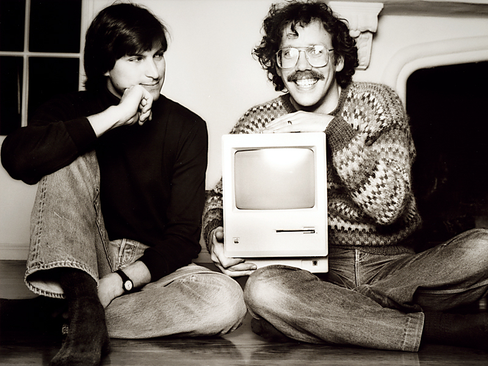
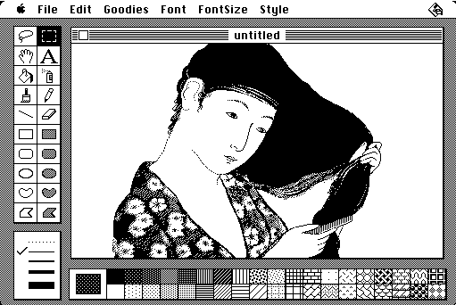
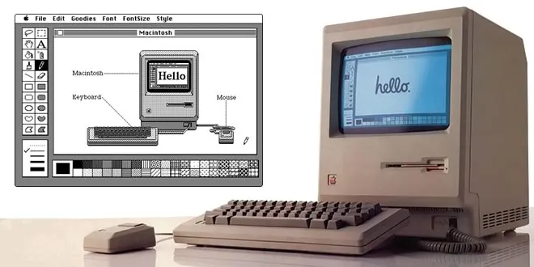
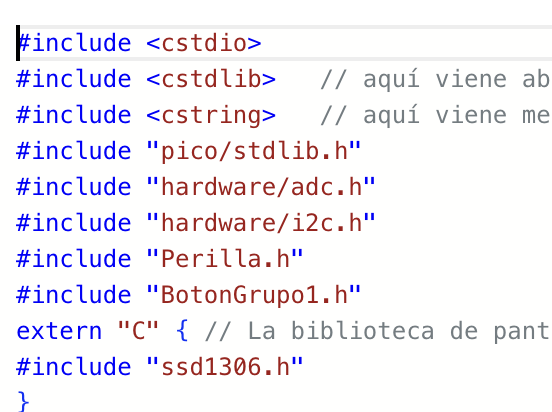
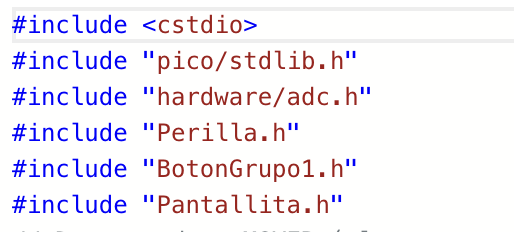
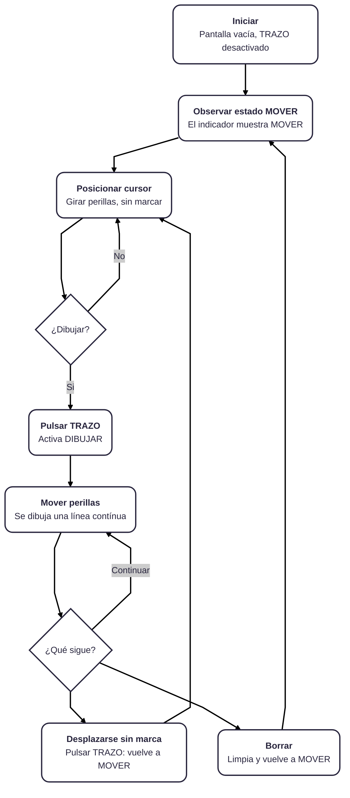
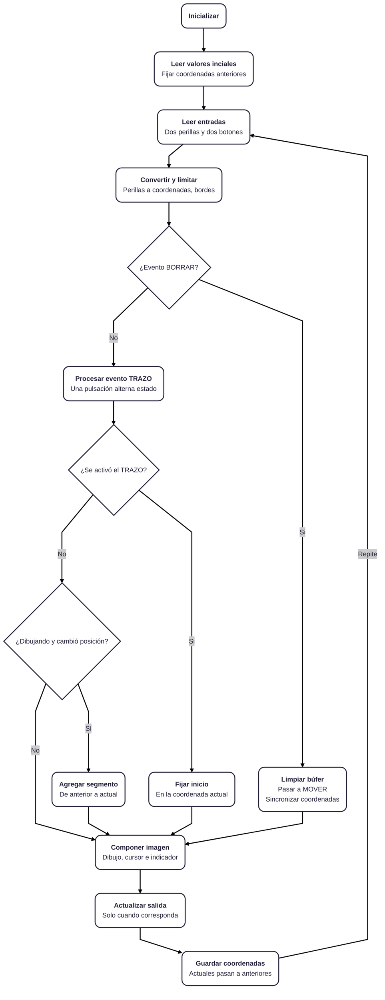
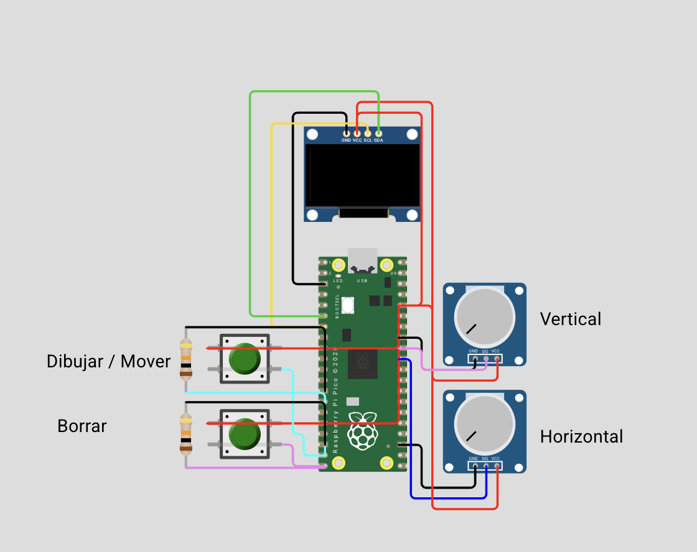
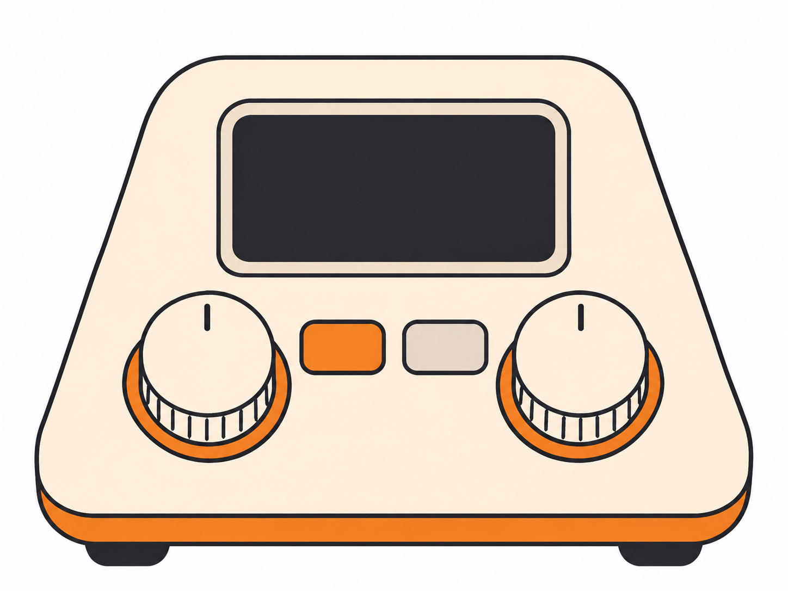

# proyecto-02

## TRAZO

### Integrantes

- Isidora Díaz [@isiidoraadiiaz](https://github.com/isiidoraadiiaz)
- Natalia Gutierrez [@blosssom-n](https://github.com/blosssom-n)
- Carlo Martínez [@zaaaiko](https://github.com/zaaaiko)
- Natalia Pilar [@sz-mada](https://github.com/sz-mada)

## 01. ¿Qué es TRAZO?

TRAZO es una máquina de dibujo digital que funciona mediante dos perillas. La idea es poder crear dibujos sobre una pantalla, pero en lugar de utilizar un mouse o un lápiz digital, los trazos se forman a partir del movimiento de estos controles.

Para desarrollarlo utilizamos una Raspberry Pi Pico, dos potenciómetros, dos botones y una pantalla OLED de 128 × 64 píxeles.

Cada potenciómetro controla un eje diferente: uno permite mover el cursor horizontalmente (X) y el otro verticalmente (Y).

Además, incorporamos dos estados: **MOVER**, que permite desplazarnos sin dejar marcas, y **DIBUJAR**, que conecta las posiciones del cursor para crear líneas. Un segundo botón permite borrar el dibujo y comenzar nuevamente.

Lo que nos interesa es experimentar con una forma distinta de dibujar, donde debemos coordinar dos movimientos independientes para construir una imagen.

## 02. Investigación y referente: MacPaint (1984)

Nuestra investigación comenzó explorando cómo los dispositivos digitales transforman movimientos físicos en representaciones gráficas.

Dentro de esta búsqueda encontramos **MacPaint**, un programa desarrollado por Bill Atkinson y lanzado por Apple en 1984 junto al primer Macintosh.

MacPaint permitía dibujar mediante un mouse, utilizando herramientas como lápices, pinceles, borradores y figuras geométricas. Su lenguaje visual estaba basado en píxeles y representaciones en blanco y negro.

También utilizaba QuickDraw, un sistema gráfico que permitía representar elementos visuales en pantalla.

Lo que más nos interesó fue comprender cómo el movimiento del mouse podía convertirse en una línea digital.

De este referente rescatamos:

- **El movimiento convertido en dibujo:** una acción física que genera una representación gráfica.
- **La simplicidad:** controles y herramientas fáciles de comprender.
- **La experimentación:** dibujar, equivocarse, borrar y volver a comenzar.
- **La respuesta visual:** observar el resultado mientras interactuamos.

En TRAZO reinterpretamos estos principios reemplazando el mouse por dos potenciómetros.

## 03. ¿Cómo llevamos la idea a TRAZO?

Para transformar el movimiento de las perillas en dibujo, utilizamos los valores analógicos de dos potenciómetros.

Al girarlos, cambia el voltaje que recibe la Raspberry Pi Pico. El programa interpreta estos valores y los convierte en coordenadas dentro de la pantalla.

El funcionamiento se organiza en cuatro etapas:

1. **Entrada:** movimiento de las perillas y pulsaciones de botones.
2. **Lectura:** la Raspberry Pi Pico recibe los valores.
3. **Procesamiento:** el código calcula coordenadas y determina qué acción realizar.
4. **Salida:** la pantalla representa el cursor, los trazos y el estado.

La diferencia principal con MacPaint es que el movimiento no depende de una sola herramienta, sino de la coordinación de dos ejes independientes.

## 04. Componentes y circuito

| Componente | Función |
|---|---|
| Raspberry Pi Pico | Procesar las entradas y ejecutar el programa. |
| Dos potenciómetros | Controlar los ejes X e Y. |
| Pantalla OLED SSD1306 | Mostrar cursor, líneas y estado. |
| Botón TRAZO | Alternar MOVER y DIBUJAR. |
| Botón BORRAR | Limpiar el dibujo. |

**Conexiones utilizadas:**

- Perilla X: GP26.
- Perilla Y: GP27.
- Botón TRAZO: GP14.
- Botón BORRAR: GP15.
- OLED: SDA GP4 y SCL GP5.

**[IMAGEN: KICAD]**

https://wokwi.com/projects/479331745306537985

## 05. Investigación de bibliotecas

Durante el proceso investigamos bibliotecas que nos permitieran controlar los componentes electrónicos sin tener que programar todas sus funciones desde cero.

Inicialmente revisamos **Adafruit SSD1306 y Adafruit GFX**, utilizadas para trabajar con pantallas y elementos gráficos.

Sin embargo, nuestro proyecto utiliza C++ con Pico SDK, por lo que necesitábamos herramientas compatibles con ese entorno.

Finalmente trabajamos con:

| Biblioteca o módulo | Función |
|---|---|
| `pico/stdlib.h` | Funciones generales del programa. |
| `hardware/adc.h` | Lectura de los potenciómetros. |
| `hardware/i2c.h` | Comunicación con la OLED. |
| `pico-ssd1306` | Control de la pantalla y representación gráfica. |

Esta investigación nos permitió comprender que las bibliotecas deben seleccionarse según su compatibilidad y las necesidades reales del proyecto.

## 06. Proceso de programación

Desarrollamos TRAZO mediante diferentes versiones para comprender cada parte del funcionamiento antes de integrarlas.

| Código | Avance principal |
|---|---|
| **1** | Planificamos el funcionamiento mediante comentarios. |
| **2** | Organizamos la estructura inicial del programa. |
| **3** | Incorporamos las perillas y estudiamos un error de conversión ADC. |
| **4** | Corregimos la conversión de valores analógicos. |
| **5** | Integramos los botones recibidos y las funciones de dibujo. |
| **6** | Reorganizamos el programa y trabajamos con la pantalla integrada en `main.cpp`. |
| **7** | Creamos una clase independiente para administrar la pantalla. |

### Corrección de los Códigos 3 y 4

En el Código 3 introdujimos intencionalmente un error de división entera para estudiar cómo afectaba la conversión de los valores analógicos.

Al dividir antes de multiplicar, se perdía la parte decimal y el cursor no podía representar correctamente las posiciones intermedias.

En el Código 4 corregimos la operación, multiplicando primero y dividiendo después.

Esto nos permitió comprender mejor cómo el orden de las operaciones afecta el resultado del programa.

### Integración del Código 5

En esta versión incorporamos la clase de botones que recibimos de otro grupo.

Con esto pudimos reunir las funciones principales: mover el cursor, activar y desactivar el dibujo y borrar los trazos.

También incorporamos una franja superior para indicar el estado y un sistema de memoria gráfica para conservar los dibujos mientras el cursor se desplaza.

### Cambios del Código 6 al Código 7

Uno de los cambios más importantes fue **crear una clase específica para la pantalla: `Pantallita.h` y `Pantallita.cpp`.**

Anteriormente, `main.cpp` contenía tanto las decisiones del programa como gran parte de las instrucciones relacionadas con la pantalla.

Al separar estas responsabilidades, conseguimos organizar mejor el código.

La nueva clase reúne funciones para:

- Inicializar la pantalla.
- Limpiar el dibujo.
- Dibujar líneas.
- Mostrar el cursor y el estado actual.

Así, `main.cpp` queda encargado principalmente de coordinar las entradas, los estados y las acciones.

Este cambio nos ayudó a comprender mejor la programación mediante clases y la importancia de mantener cada responsabilidad separada.

## 07. Intercambio de clases con el Grupo 1

Una parte importante del proyecto fue el intercambio de clases entre grupos.

Nuestro equipo desarrolló una clase para trabajar con perillas, mientras que también recibimos una clase de botones para incorporar a TRAZO.

### Adaptación de nuestra clase Perilla

Inicialmente trabajamos con las clases `Perilla` y `Encoder` por separado.

Sin embargo, al conversar con el **Grupo 1**, nos explicaron que su proyecto necesitaba utilizar un encoder para seleccionar sonidos y un potenciómetro para controlar el volumen.

Además, nos compartieron un repositorio del profesor que nos permitió investigar cómo reunir ambos comportamientos en una sola clase.

A partir de esto desarrollamos una segunda versión de `Perilla`, capaz de trabajar con los dos tipos de controles.

En TRAZO seguimos utilizando la parte correspondiente a los potenciómetros, mientras que el Grupo 1 necesitaba también las funciones del encoder.

Este intercambio nos llevó a adaptar una clase a necesidades diferentes de las de nuestro propio proyecto.

### Clase de botones recibida

También incorporamos `BotonGrupo1.h` y `BotonGrupo1.cpp`, desarrollados por otro grupo.

Esta clase nos permitió detectar las pulsaciones y controlar el rebote de los botones.

La integración fue importante porque tuvimos que comprender código que no habíamos escrito nosotras y adaptarlo a la estructura de TRAZO.

## 08. Diagramas de flujo

Para organizar el funcionamiento desarrollamos dos diagramas: uno que representa la experiencia del usuario y otro que explica las decisiones internas del programa.

### Diagrama de flujo del usuario

Este diagrama muestra cómo la persona comienza en MOVER, posiciona el cursor, activa DIBUJAR y decide si continuar, desplazarse sin marcar o borrar.

### Diagrama de flujo del programa

Este segundo diagrama representa las lecturas de los controles, la conversión de coordenadas, las decisiones de los botones y la actualización de pantalla.

Ambos nos ayudaron a ordenar la interacción y comprender la relación entre entradas, procesamiento y salida.

## 09. Simulación y pruebas

Utilizamos Wokwi para representar el circuito y trabajar con los componentes de manera virtual.

Durante el desarrollo revisamos especialmente:

- La lectura independiente de ambas perillas.
- La conversión de los valores analógicos.
- El movimiento del cursor.
- La diferencia entre MOVER y DIBUJAR.
- La conservación de las líneas.
- El funcionamiento de los botones.
- La actualización de la pantalla.

Las pruebas de conversión ADC quedaron registradas en las versiones anteriores. Las pruebas integrales del Código 7 deben documentarse con sus resultados y evidencias.

## 10. Diseño de carcasa

Esta etapa corresponde al desarrollo físico de TRAZO.

Hasta ahora hemos trabajado principalmente con la simulación y el funcionamiento electrónico. La carcasa nos permitirá explorar cómo integrar los componentes en un objeto que pueda utilizarse cómodamente.

### 10.1. Investigación de referentes

Para comenzar a diseñar la carcasa de TRAZO, buscamos referentes de dispositivos electrónicos interactivos que tuvieran una distribución sencilla de controles y una forma cómoda de utilizar sobre un escritorio.

Nos interesaron especialmente los computadores compactos de los años 80, los sintetizadores y algunos controladores electrónicos que utilizan perillas como principal forma de interacción.

De estos referentes rescatamos tres características principales:

Diseño retro tecnológico

Nos inspiramos en los primeros computadores personales, especialmente en sus formas compactas, superficies redondeadas y combinaciones de colores claros. Queríamos que TRAZO tuviera una apariencia tecnológica, pero que al mismo tiempo se sintiera como un objeto cercano y fácil de utilizar.

Controles físicos protagonistas

También observamos dispositivos como sintetizadores y controladores musicales, donde las perillas tienen un papel importante tanto en el funcionamiento como en la apariencia del objeto. Nos interesó utilizar controles grandes, fáciles de identificar y con suficiente separación para manipularlos cómodamente.

Inclinación y ergonomía

Otro aspecto que rescatamos fue la inclinación de las superficies de control. Esto permite que la pantalla y los botones queden orientados hacia la persona que utiliza el dispositivo, facilitando su lectura e interacción.

A partir de estas referencias decidimos desarrollar una carcasa compacta, con una superficie superior inclinada, dos perillas principales y dos botones independientes.

### 10.2. Bocetos y propuestas

**[BOCETO]**

A partir de la investigación comenzamos a explorar distintas formas para la carcasa. Queríamos evitar una caja rectangular tradicional y conseguir una forma que se sintiera más cercana a un pequeño instrumento de escritorio.

La propuesta que seleccionamos tiene una base rectangular con esquinas redondeadas y una estructura inclinada que aumenta su altura hacia la parte posterior.

Esta forma nos permite distribuir los componentes en una misma superficie, manteniendo una separación visual entre ellos.

Distribución de los componentes:

Pantalla OLED: ubicada en la zona superior y ligeramente inclinada hacia la persona que utiliza TRAZO. Es el espacio donde se visualiza el cursor y los dibujos.

Perilla X: ubicada en la zona inferior izquierda. Controla el movimiento horizontal.

Perilla Y: ubicada en la zona inferior derecha. Controla el movimiento vertical.

Botón TRAZO: ubicado entre las dos perillas. Permite alternar entre los modos MOVER y DIBUJAR.

Botón BORRAR: ubicado junto al botón TRAZO. Permite limpiar la pantalla y comenzar un nuevo dibujo.

Decidimos mantener las dos perillas como los elementos principales de la superficie, ya que son los controles que se utilizan constantemente durante la interacción.

Visualmente, propusimos una carcasa color crema con una franja inferior naranja, detalles naranjos alrededor de las perillas y botones diferenciados por color.

### 10.3. Resultado de la carcasa

## 12. Bibliografía

- Computer History Museum. *MacPaint and QuickDraw Source Code*. https://computerhistory.org/blog/macpaint-and-quickdraw-source-code/
- Hertzfeld, A. *MacPaint Evolution*. https://www.folklore.org/MacPaint_Evolution.html
- Raspberry Pi. *Pico SDK*. https://github.com/raspberrypi/pico-sdk
- Wokwi. *SSD1306 OLED*. https://docs.wokwi.com/parts/board-ssd1306
- daschr. *pico-ssd1306*. https://github.com/daschr/pico-ssd1306
- Material docente de Procesos.
- Registro de avances y versiones de TRAZO.

## 13. Registro de uso de IA

Durante el desarrollo utilizamos ChatGPT como apoyo para organizar la estructura del programa, comprender errores, revisar compatibilidad de bibliotecas y documentar el proceso.

Entre los usos registrados se encuentran:

- Código 1: planificación del funcionamiento mediante comentarios.
- Código 2: estructura inicial de Pico SDK.
- Códigos 3 y 4: estudio y corrección de la conversión ADC.
- Intercambio de clases: adaptación de Perilla y Encoder a una sola clase.
- Códigos 5 a 7: apoyo para comprender la integración, reorganización y separación de responsabilidades.

Los prompts completos y las respuestas utilizadas deben conservarse en el registro de desarrollo del proyecto.
