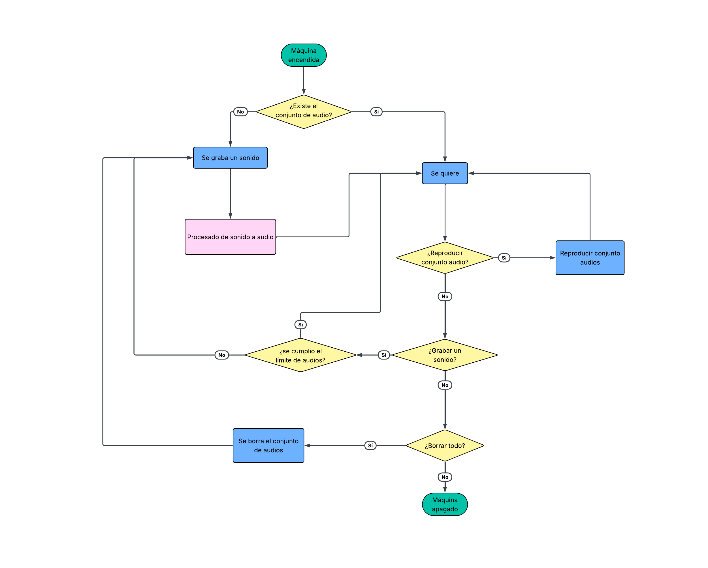
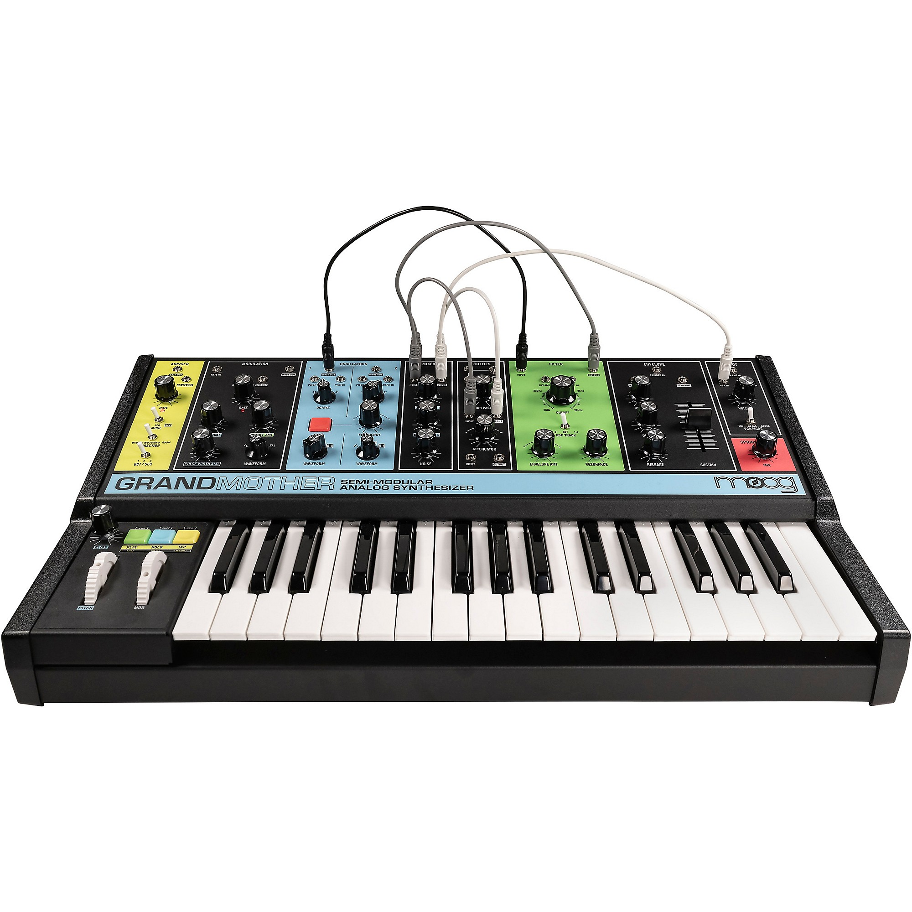

# grupo-01

## integrantes

- [19 - Dayana Pañitrur](https://www.github.com/dayanapanitrur)
- [23 - Camila Ramírez](https://www.github.com/Estrabismx)
- [29 - Bianka Vilchez](https://www.github.com/biankavilchez)

## sobre el proyecto

Nuestra máquina es un instrumento que no es musical ¿o si? es la intervención humana la que lo decide y lo hará por medio de la captura, edición y reproducción del sonido. Por cada nueva intervención que se vaya acumulando sobre la anterior, generará capas de sonido que progresivamente alteran el registro original. Utiliza una lógica de edición irreversible por cada audio que se graba, con efectos y modulaciones de sonido que solo se podrán aplicar para los sonidos grabados más no para el conjunto total de estos, de esta forma las intervenciones quedan almacenadas y transforman continuamente el resultado del conjunto de sonidos. El registro solo se puede reproducir desde el inicio o detener completamente, sin poder recuperar o editar libremente un punto específico del proceso. La lógica irreversible también aplica para el conjunto final de sonidos, el cuál no se puede borrar, solo puede llegar a un límite de audios almacenados.

Dentro del funcionamiento técnico, este es controlado por un microcontrolador Raspberry Pi Pico 2W, el cual se encarga de gestionar las entradas de la interfaz física y el procesamiento del sonido y su manipulación. Para asegurar un rendimiento continuo y evitar las limitaciones de memoria al trabajar con audios muy largos o con muchas capas, el sistema integra un módulo de tarjeta SD, que permite almacenar, sobreescribir y reproducir el conjunto de sonidos grabados de manera fluida.

### Posibilidades dentro del aspecto de audio

El tiempo máximo de grabación por cada audio es de 30 segundos.

Cada 10 segundos se da la orden de reproducir un audio.

Son 60 posibilidades donde podría iniciar un audio.

<br>

### Diagramas




### pseudo - código

- Se establece que `sonido` es una grabación sin ninguna modificación, la cual al editar sus parámetros la entendemos como `audio` y una vez que se guarda, se añade a las demás y forma un `conjuntoDeAudios`. Todos los `audios` guardados se reproducen en nuestro `canvas`, es decir, nuestro lienzo que podemos reproducir en cualquier momento pero no editar

- Se inicia la máquina con el interruptor

```cpp

bool interruptorGeneral; // valor asociado a la lectura del switch o botón 
bool funcionamientoMaquina; // depende del interruptorEncendido
// si es true la maquina realiza sus funciones con normalidad
// si es false, la maquina debe tener un led encendido que indica que recibe corriente

if (interruptorGeneral){
funcionamientoMaquina = 1;}

```

- Se consulta si hay `conjuntoDeAudios`

- En caso de haber, se encienden 3 leds que indican la posibilidad de realizar 3 acciones (es decir que cada `led` es un indicador de uso de cada modo), estos corresponden a `reproduccion`, `grabacion` y `borrado`

    - `reproduccion` permite escuchar el `conjuntoDeAudios`

        - Al activar esta opción, se inhabiltan los demás modos meintras dure la reproducción (se apagan sus leds indicadores)

        - Si se vuelve a presionar `reproduccion` mientras suena el `conjuntoDeAudios` se cancela el modo

        - Si se hace `dobleClick` al momento de activar `reproduccion`, se habilita el modo bucle
        
    - `grabacion` permite guardar sonidos de hasta un máximo de 10 segundos

        - Estos sonidos luego se pueden editar variando velocidad, tono...

        - Mientras esto ocurre se bloquea cualquier otro modo

        - Solo se permite salir guardando el `audio`

        - Una vez guardado el `audio` se le asigna una posición "aleatoria" en la que va a sonar en el `conjuntoDeAudios`

    - `borrado` elimina `conjuntoDeAudios`, dejando la memoria vacia esperando nuevos `audios`

        - Una vez ocurre esto se está forzado a solo poder grabar un `sonido`

- En caso de no haber `conjuntoDeAudios` se bloquean todas las funciones a exepción de `grabar`, la cual al iniciarse ocurre con normalidad tal como se describio anteriormente

- Si la máquina es apagada desde el `interruptorGeneral`, el `conjuntoDeAudios` debe quedar almancenado

#### Estructura

Se considera ordenar el código en distintas clases, a continuación se listan algunas a considerar

- Boton (lectura de botones)

- Perilla (lectura de perillas)

- Multiplexor (pensado en la un multiplexor para optimizar la lecutra de perillas)

- Lucesita (describen el funcionamiento de los distintos estados)

- [NombreEfecto] (se encarga de la complejidad de como debe modificar el `audio`)

- Aleatoriedad (es una estructura que simula aleatoriadad necesaria para el funcionamiento de la máquina)

- Conversor (lógica detrás de la placa ---- que convierte audio digital a análogo)

- Amplificacion (lógica detrás de la placa ---- que convierte amplifica el sónido)

- Reproduccion (define al modo `reproduccion`)

- Grabar (define al modo `grabar`)

- Borrar (define al modo `borrar`)

- Microfono (establece como se comunica el micrófono con el microcontrolador)

- SDCard (se encarga de la lógica detrás de la grabación y lectura de datos)


### Wokwi

https://wokwi.com/projects/480724591872061441

## Referentes

### [NYQUIST - Bit Crush](https://notpedals.com/products/nyquist)

<br>


<br>

### [Mini Glitch](https://electricmojoguitars.com/products/tkog-mini-glitch)


<br>

### [MOOG GRANDMOTHER](https://www.moogmusic.com/synthesizers/grandmother/)



### [Kaleidoloop](https://forum.critterandguitari.com/t/kaleidoloop-returns/10321)


### [Circuito Integrado LPC2138FBD64](https://www.y-ic.com/pdf/Freescale-NXP-Semiconductors/LPC2138FBD64.html)


