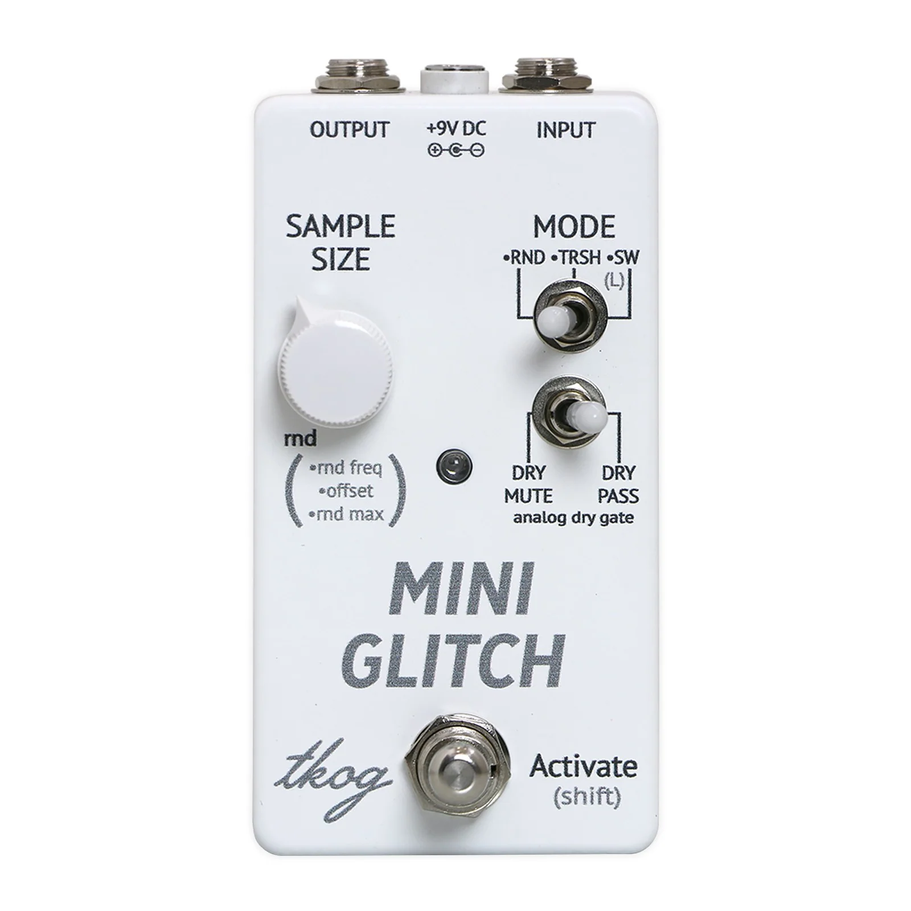

# grupo-01

## integrantes

- [19 - Dayana Pañitrur](https://www.github.com/dayanapanitrur)
- [23 - Camila Ramírez](https://www.github.com/Estrabismx)
- [29 - Bianka Vilchez](https://www.github.com/biankavilchez)

## sobre el proyecto

## Referentes

### [NYQUIST - Bit Crush](https://notpedals.com/products/nyquist)

 

 

### [Mini Glitch](https://electricmojoguitars.com/products/tkog-mini-glitch)

 

### [MOOG GRANDMOTHER](https://www.moogmusic.com/synthesizers/grandmother/)

