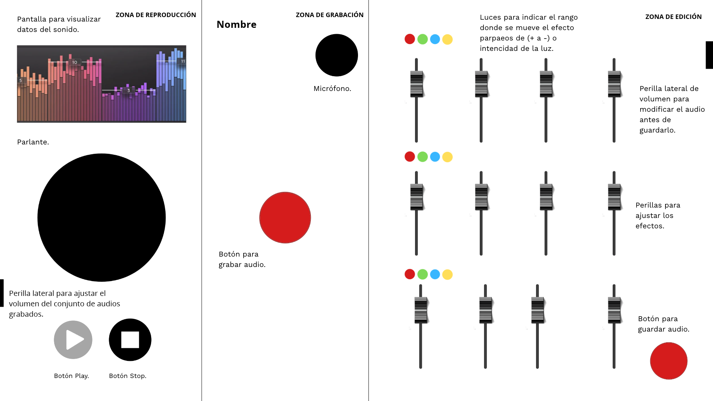
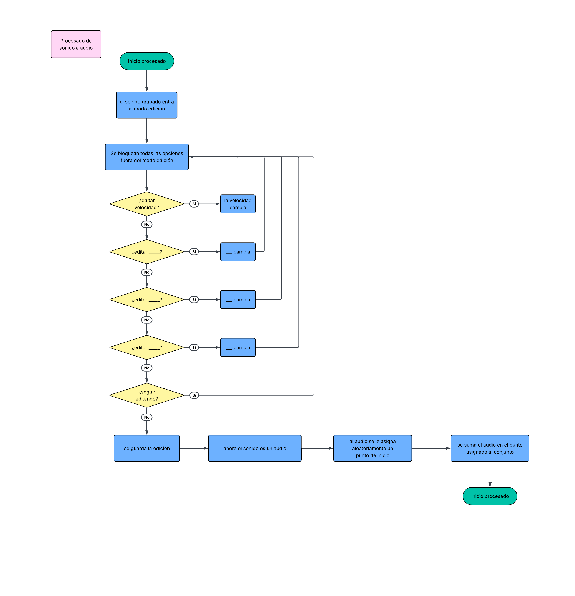

# grupo-01

## integrantes

- [19 - Dayana Pañitrur](https://www.github.com/dayanapanitrur)
- [23 - Camila Ramírez](https://www.github.com/Estrabismx)
- [29 - Bianka Vilchez](https://www.github.com/biankavilchez)

## sobre el proyecto

Nuestra máquina es un instrumento que no es musical ¿o si? es la intervención humana la que lo decide y lo hará por medio de la captura, edición y reproducción del sonido. Por cada nueva intervención que se vaya acumulando sobre la anterior, generará capas de sonido que progresivamente alteran el registro original. Utiliza una lógica de edición irreversible por cada audio que se graba, con efectos y modulaciones de sonido que solo se podrán aplicar para los sonidos grabados más no para el conjunto total de estos, de esta forma las intervenciones quedan almacenadas y transforman continuamente el resultado del conjunto de sonidos. El registro solo se puede reproducir desde el inicio o detener completamente, sin poder recuperar o editar libremente un punto específico del proceso. La lógica irreversible también aplica para el conjunto final de sonidos, el cuál no se puede borrar, solo puede llegar a un límite de audios almacenados.

Dentro del funcionamiento técnico, este es controlado por un microcontrolador Raspberry Pi Pico 2W, el cual se encarga de gestionar las entradas de la interfaz física y el procesamiento del sonido y su manipulación. Para asegurar un rendimiento continuo y evitar las limitaciones de memoria al trabajar con audios muy largos o con muchas capas, el sistema integra un módulo de tarjeta SD, que permite almacenar, sobreescribir y reproducir el conjunto de sonidos grabados de manera fluida.

### Interfaz

La interfaz se organiza en tres zonas principales: reproducción, grabación y edición. La zona de reproducción se ubica a la izquierda e incorpora una pantalla para visualizar los datos del sonido, un parlante y los botones Play y Stop. Se decide incorporar una perilla de volumen en el lateral, ya que, al enfrentarse a la máquina, el usuario encontrará esta primera sección. Por ello, se considera importante disponer de este control cerca del botón Play, facilitando el ajuste del volumen durante la reproducción.

La zona de grabación se dispone al centro y contiene un micrófono y un botón para iniciar la captura de audio. Finalmente, la zona de edición se ubica a la derecha y reúne perillas deslizantes para modificar los efectos, acompañadas de indicadores luminosos de colores que permiten identificar visualmente sus rangos e intensidades. En el lateral de esta sección se incorpora otra perilla para ajustar el volumen del audio antes de guardarlo.

Con esta distribución se busca generar una lectura intuitiva de izquierda a derecha, como una guía de pasos que orienta al usuario a través de las distintas acciones: reproducir, grabar y editar. De esta manera, se diferencian las funciones, se facilita la lectura de los controles y se hace más intuitiva la interacción con el dispositivo.

### Posibilidades dentro del aspecto de audio

El tiempo máximo de grabación por cada audio es de 30 segundos.

Cada 10 segundos se da la orden de reproducir un audio.

Son 60 posibilidades donde podría iniciar un audio.

 

### Diagramas

### Wokwi

https://wokwi.com/projects/480724591872061441

## Referentes

### [NYQUIST - Bit Crush](https://notpedals.com/products/nyquist)

 

 

### [Mini Glitch](https://electricmojoguitars.com/products/tkog-mini-glitch)

 

### [MOOG GRANDMOTHER](https://www.moogmusic.com/synthesizers/grandmother/)

### [Kaleidoloop](https://forum.critterandguitari.com/t/kaleidoloop-returns/10321)

### [Circuito Integrado LPC2138FBD64](https://www.y-ic.com/pdf/Freescale-NXP-Semiconductors/LPC2138FBD64.html)

