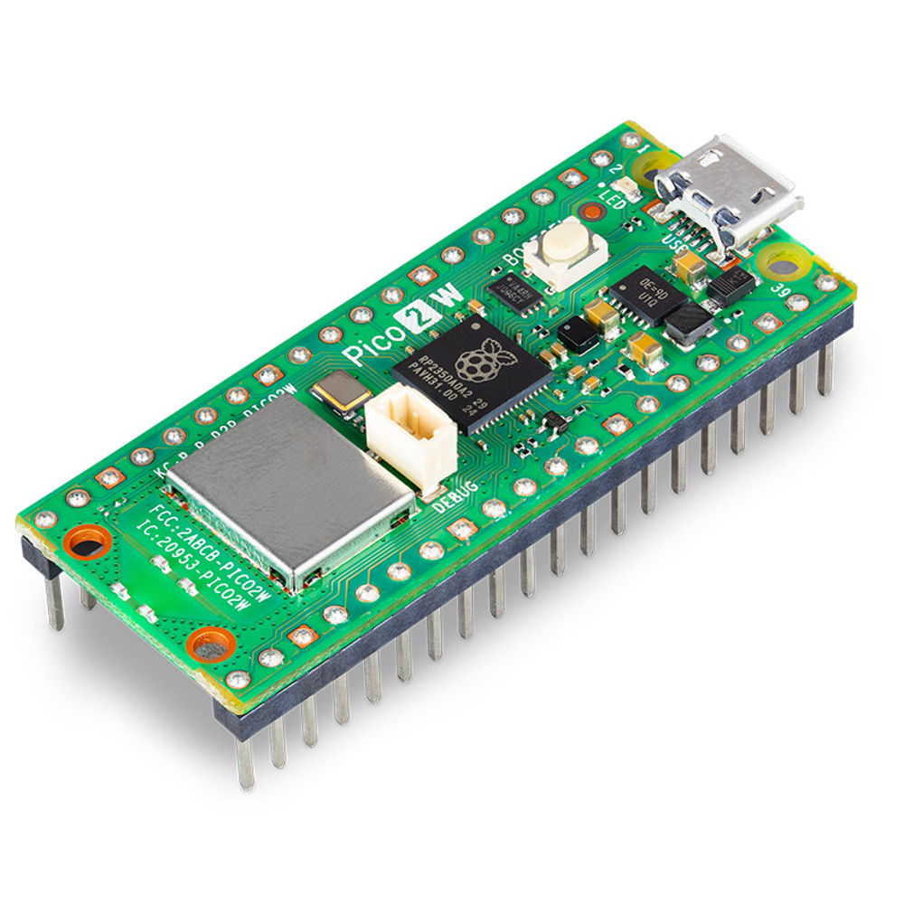
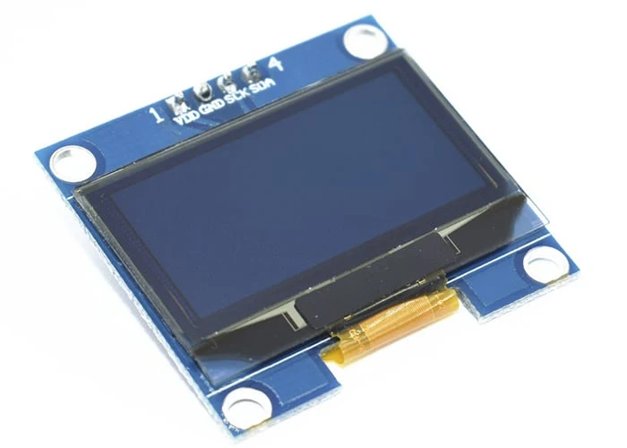
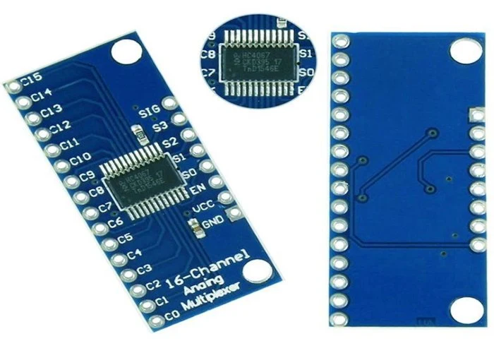
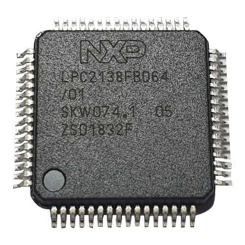

# grupo-01

## integrantes

- [19 - Dayana Pañitrur](https://www.github.com/dayanapanitrur)
- [23 - Camila Ramírez](https://www.github.com/Estrabismx)
- [29 - Bianka Vilchez](https://www.github.com/biankavilchez)

## sobre el proyecto

Nuestra máquina es un instrumento que no es musical ¿o sí? sin la intervención de quien la usa no produce nada, pero lo que resulta sea música o ruido depende de quien lo escucha. Nuestro proyecto recorre 3 etapas de interacción: captura, edición y reproducción del sonido. En la fase de captura, se incorpora un botón y un micrófono el cuál está articulado para que la persona pueda grabar su voz, disponiendo de un máximo de 30 segundos por grabación.

En la etapa de edición, cada grabación utiliza una lógica de edición irreversible. El dispositivo tiene una sección física de edición con efectos y modulaciones, controlables con deslizadores, perillas y botones. Al terminar una grabación, esta queda repitiéndose en bucle disponible para ser editada y solo a esta se le podrán aplicar los efectos. Una vez que ya se hayan hecho los cambios y almacenado a la mezcla de sonidos, ya no se podrán realizar más modificaciones.

En la etapa de reproducción las grabaciones se acumulan en una mezcla de unos diez minutos, dividida en 60 puntos de inicio, uno cada 10 segundos. Cada nueva grabación se ubica en uno de esos puntos y como puede durar hasta 30 segundos, se superpone con las que suenan cerca de ella. La lógica irreversible que se incorpora para cada audio individual, también aplica para la mezcla de sonidos, de esta manera solo se puede reproducir desde el principio o detener por completo: no se puede pausar ni avanzar a un punto específico. Tampoco se puede borrar. Una vez que los 60 puntos de inicio hayan sido totalmente ocupados, la máquina ya no permite grabar más, solo reproducir la mezcla final. El sonido sale por un altavoz con una perilla de volumen, y una pantalla muestra una abstracción gráfica de cuán saturada está la mezcla.

Dentro del funcionamiento interno, este dispositivo es controlado por una Raspberry Pi Pico 2 W, la cual se encarga de gestionar las entradas y salidas de la interfaz física correspondientes a las conexiones con perillas, sliders, botones, leds, altavoz y pantalla, y también gestiona el procesamiento del sonido y su manipulación. Para asegurar un rendimiento continuo y evitar las limitaciones de memoria de la Raspi al trabajar con audios muy largos o con muchas capas, el sistema integra un módulo de tarjeta SD, que permite almacenar y reproducir el conjunto de sonidos grabados de manera fluida.


### Interfaz


La interfaz se organiza en tres zonas principales: reproducción, grabación y edición. La zona de reproducción se ubica a la izquierda e incorpora una pantalla para visualizar los datos del sonido, un parlante y los botones Play y Stop. Se decide incorporar una perilla de volumen en el lateral, ya que, al enfrentarse a la máquina, el usuario encontrará esta primera sección. Por ello, se considera importante disponer de este control cerca del botón Play, facilitando el ajuste del volumen durante la reproducción.

La zona de grabación se dispone al centro y contiene un micrófono y un botón para iniciar la captura de audio. Finalmente, la zona de edición se ubica a la derecha y reúne perillas deslizantes para modificar los efectos, acompañadas de indicadores luminosos de colores que permiten identificar visualmente sus rangos e intensidades. En el lateral de esta sección se incorpora otra perilla para ajustar el volumen del audio antes de guardarlo.

Con esta distribución se busca generar una lectura intuitiva de izquierda a derecha, como una guía de pasos que orienta al usuario a través de las distintas acciones: reproducir, grabar y editar. De esta manera, se diferencian las funciones, se facilita la lectura de los controles y se hace más intuitiva la interacción con el dispositivo.

### Posibilidades dentro del aspecto de audio

El tiempo máximo de grabación por cada audio es de 30 segundos.

Cada 10 segundos se da la orden de reproducir un audio.

Son 60 posibilidades donde podría iniciar un audio.

<br>

#### Modificadores de sonido

<h5>envolventes</h5>
<ul>
  <li>attack</li>
  <li>decay</li>
  <li>sustain</li>
  <li>release</li>
</ul>

<h5>fx / modulación</h5>
<ul>
  <li>pitching</li>
  <li>reverb</li>
  <li>trémolo</li>
  <li>bit crushing</li>
  <li>ring modulator</li>
  <li>velocidad</li>
</ul>

<h5>ecualización</h5>
<ul>
  <li>high pass filter</li>
</ul>

<h5>niveles / ganancia</h5>
<ul>
  <li>volumen de audio</li>
  <li>volumen general</li>
</ul>

<br>

### Diagramas


### BOM

| # | Item                 | Cant. | Valor   | Link | Imagen |
| - | -------------------- | ----- | ------- | ---- | ------ |
| 1 | Raspberry Pi Pico 2W | 01     | $14.990 | <https://mcielectronics.cl/shop/product/raspberry-pi-pico-2-w-con-headers/> |  |
| 2 | Micrófono I2S INMP441 | 01 | $5.890<sup><b>1</b> | <https://www.mechatronicstore.cl/modulo-microfono-i2s-inmp441/> |  |
| 3 | PCM5102A decodificador DAC | 01 | $1.122<sup><b>2</b> | <https://es.aliexpress.com/item/1005006104038963.html> |  |
| 4 | Módulo PAM8302 | 01 | $720<sup><b>2</b> | https://es.aliexpress.com/item/1005007274382818.html |  |
| 5 | Pantalla LCD Oled 1.3" 128x64 | 01 | $5.000 | https://afel.cl/products/pantalla-lcd-oled-1-3-128x64-caracteres-azules | 
| 6 | Módulo Multiplexor CD74HC4067 | 02 | $2.000 | https://afel.cl/products/modulo-multiplexor-cd74hc4067 |  |
| 7 | Botones | 
| 8 | Potenciometros |
| 9 | Luces led |
| 10 | Slider |

### pseudo - código

- Se establece que:
  - `sonido` es una grabación sin ninguna modificación. Es nuestro pez
  -  Al editar sus parámetros la entendemos como `audio`. Ahora nuestro pez es un pescado
  - Una vez que se guarda, se añade a los demás `audios` y forma un `conjuntoDeAudios`. Este es nuetro pescado cocinado, no se puede "_**des**cocinar_"
  -Todos los `audios` guardados se reproducen en nuestro `canvas`, es decir, nuestro lienzo que podemos reproducir en cualquier momento pero no editar. El equivalente a decir el tamño del plato

- Ahora se inicia la máquina con el interruptor

```cpp

bool interruptorGeneral; // valor asociado a la lectura del switch o botón 
bool funcionamientoMaquina; // depende del interruptorEncendido
// si es true la maquina realiza sus funciones con normalidad
// si es false, la maquina debe tener un led encendido que indica que recibe corriente

if (interruptorGeneral){
funcionamientoMaquina = 1;}

```

- Se consulta si hay `conjuntoDeAudios`

- En caso de haber, se encienden 2 leds que indican la posibilidad de realizar 2 acciones (es decir que cada `led` es un indicador de uso de cada modo), estos corresponden a `reproduccion` y `grabacion`

    - `reproduccion` permite escuchar el `conjuntoDeAudios`

        - Al activar esta opción, se inhabilta el modo grabar mientras dure la reproducción (se apagan sus leds indicadores y los bótones dejar de ser leidos)

        - Posee 2 botones, uno de `reproducción` y otro de `detener` (no confundir con `pausa`), este segundo detiene la reproducción del `conjuntoDeAudios` y deja seteado en el inicio el `canva`, de modo que si se vuelve a dar a reproducir se hará desde el segundo 0 

        - La reproducción de `audios` es siempre en bucle
        
    - `grabacion` permite guardar sonidos de hasta un máximo de 10 segundos

        - Para grabar se presiona el boton asociado

        - para detener la grabacion antes de los 10s se vuelve a presionar el botón. Esto inicia automáticamente el modo de `edición`

        - Mientras esto ocurre se bloquea cualquier otro modo e inica la reproducción en bucle del sonido hasta que se guarde

        - Además los leds asociados a los efectos empiezan a variar su brillo mediante PWM

        - Estos efectos de sonido se dividen en 3 secciones con 3 modificadores cada una

        - Cada sección posee su potenciómetro deslizable que modifica los valores asociados

        - Al seleccionar un efecto se mantiene oscilando el led, mientras que todos los demás se apagan

        - Para terminar con el efecto y guardar sus cambios se presiona el botón asociado o se selecciona otro efecto

        - Al terminar de editar se guarda el `audio` con su botón asignado y se deja de reproducir en bucle

        - Una vez guardado el `audio` se le asigna una posición "aleatoria" en la que va a sonar en el `conjuntoDeAudios`

- En caso de no haber `conjuntoDeAudios` se bloquean todas las funciones a exepción de `grabar`, la cual al iniciarse ocurre con normalidad tal como se describio anteriormente

- Si la máquina es apagada desde el `interruptorGeneral`, el `conjuntoDeAudios` debe quedar almancenado

#### Modo Reproducir

#### Modo Grabar

##### Modo Editar

#### Estructura

Se considera ordenar el código en distintas clases, a continuación se listan algunas a considerar

- Boton (lectura de botones)

- Perilla (lectura de perillas)

- Multiplexor (pensado en un multiplexor para optimizar la lecutra de perillas)

- Lucesita (describen el funcionamiento de los distintos estados)

- [NombreEfecto] (se encarga de la complejidad de como debe modificar el `audio`)

- Aleatoriedad (es una estructura que simula aleatoriadad necesaria para el funcionamiento de la máquina)

- Conversor (lógica detrás de la placa ---- que convierte audio digital a análogo)

- Amplificacion (lógica detrás de la placa ---- que convierte amplifica el sónido)

- Reproduccion (define al modo `reproduccion`)

- Grabar (define al modo `grabar`)

- Borrar (define al modo `borrar`)

- Microfono (establece como se comunica el micrófono con el microcontrolador)

- SDCard (se encarga de la lógica detrás de la grabación y lectura de datos)


### Wokwi

https://wokwi.com/projects/480724591872061441

## Referentes

### [NYQUIST - Bit Crush](https://notpedals.com/products/nyquist)

<br>

Este es un pedal de efectos hechos con componentes analógicos. El efecto que produce es como el de pixelar el sonido, haciendo que este pierda nitidez. Nosotras rescatamos el efecto como tal y lo integramos a nuestra sección de edición de audio.


<br>

### [Mini Glitch](https://electricmojoguitars.com/products/tkog-mini-glitch)

<br>

Es un pedal que crea un glitch aleatorio en el sonido y sirve también para hacer looping experimental. Funciona capturando una muestra corta de señal y luego la repite, en otras palabras graba por sobre sí mismo y se realiza un feedback. Se inspiró en un patch de stutter en Max/MSP que usaba Jonny Greenwood, de Radiohead. Lo que rescatamos de este pedal son las funciones que tiene: el bucle, el efecto de glitch y que use su propia señal para repetir, lo cuál nuestro proyecto.


<br>

### [MOOG GRANDMOTHER](https://www.moogmusic.com/synthesizers/grandmother/)


### [Kaleidoloop](https://forum.critterandguitari.com/t/kaleidoloop-returns/10321)


### [Circuito Integrado LPC2138FBD64](https://www.y-ic.com/pdf/Freescale-NXP-Semiconductors/LPC2138FBD64.html)


