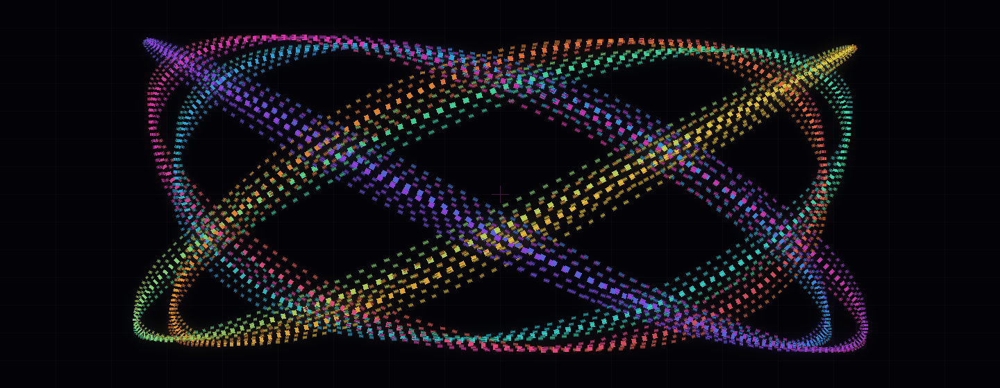

# grupo-02



## integrantes
+ ***Antonia Loch*** @antoloch
+ ***Anaís Marchausen*** @anaisbmg
+ ***Carla Nuñez*** @ccarlabelenn
+ ***Hugo Montoya*** @hugomontoya

## sobre el proyecto

#### Brainstorming
**que sí queremos**
1. Dos personas
2. Acercarse para escucharlo
3. Ambos pueden interactuar
4. Máquina que transmita sonido
5. Interactivo - mandar la señal del sonido
6. Mínimo y máximo 2 personas 
7. 1 Parlante
8. Máquina interactiva que la prioridad es la relación humana momentánea   
9. El sonido se fusiona de a y b 
10. La imagen se fusiona entre a y b
11. Parte a 4 sonidos agudos y parte b 4 sonidos graves  

**que no queremos**
1. Alarma de auto
2. Alarma de incendios
3. Despertador
4. Madera
5. Haya memoria
6. Detector de metales
7. Parlante pequeño
8. Radio
9. Máquina de arcade
10. Máquina de pago

**podría ser**
cartón
plástico

## Texto descriptivo
La propuesta consiste en dos objetos individuales, cada uno con cuatro botones a modo de teclado, que permiten a dos personas interactuar a través de sonidos predeterminados. Cada persona elige y combina los sonidos de su propio teclado, y juntas construyen un sonido que ninguna podría crear por separado.
Al fusionarse ambos sonidos, la máquina los transforma en una figura única que representa el encuentro entre las dos personas. La forma cambia según los botones que cada una selecciona, de modo que cada encuentro genera una figura distinta e irrepetible.
Todo ocurre en tiempo real y sin almacenar ningún sonido, convirtiendo la interacción en una experiencia física, visual y sonora.
Buscamos destacar la relación y la primera interacción humana, las máquinas siendo solo el medio, ya que queremos potenciar el vínculo de las personas. Generar espacios para lograr situaciones a partir de la necesidad del trabajo en pares, la experiencia no se puede completar sola, el resultado solo existe cuando ambas participan. El sonido no se guarda, ya que no buscamos el registro, si no la relación humana y nuevos lazos.
En una era donde todo se graba, se archiva, se sube a la nube y se viraliza, se propone una rebeldía: tecnología con amnesia. La interacción es radicalmente privada y volátil. Lo que ocurre entre las dos personas les pertenece únicamente a ellas en ese instante y se transforman en vínculos duraderos y verdaderos.

## Bom

| Cantidad | Componente | Descripción |
|---|---|---|
| 1 | Raspberry Pi Pico | Microcontrolador principal |
| 8 | Botones | Teclado |
| 1 | Parlante | Tomar el sonidos |
| 1 | Buzzer | Tomar la vibración |
| 1 | Láser | Emisión de luz láser |

## Diagrama de flujo

**Intervenir** cada persona debe conversar y pulsar las opciones que tiene cada una
**Pulsar** comenzar a darle características al nuevo sonido
**Dualidad** la dupla genera un nuevo sonido y las vibraciones de este nos dará el siguiente paso
**Visualizar** gracias al láser podremos ver las vibraciones en forma de oscilador

**inicio → dos personas → cada uno pulsa opciones disponibles → genera nueva melodía → perturban el parlante → visualizar el láser con figuras creadas desde el sonido**

**inicio**

```cpp
disponible parlante
disponible buzzer
disponible laser
disponible botón A1, A2, A3 y A4
//sonidos agudos
disponible botón B1, B2, B3 y B4
//sonidos graves 

//mínimo y máximo de 2 personas
//no existe memoria, no se guarda el sonido

estado = activo
```
—-------------------- FALTA

## Wokwi
es uno inicial, falta aun

Tenemos preguntas, ya que nos gustaria que cada teclado tenga sonido de notas musicales, eso como se puede representar en wokwi, ademas del laser

https://wokwi.com/projects/480951299269584897

## Referentes 

## Bibliografia
