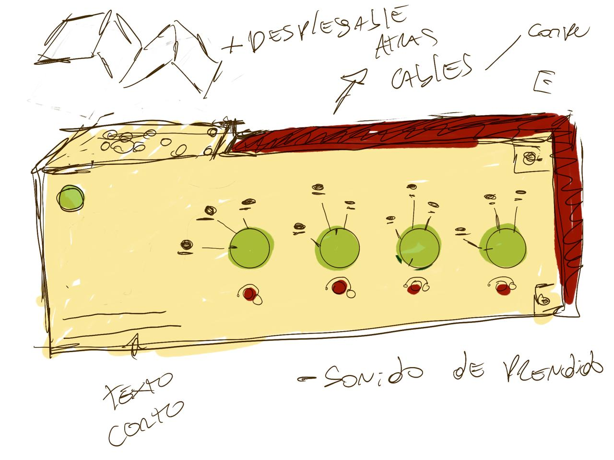
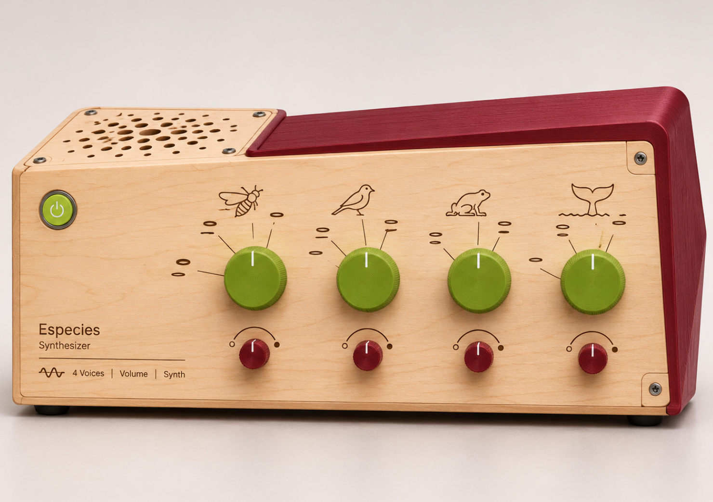
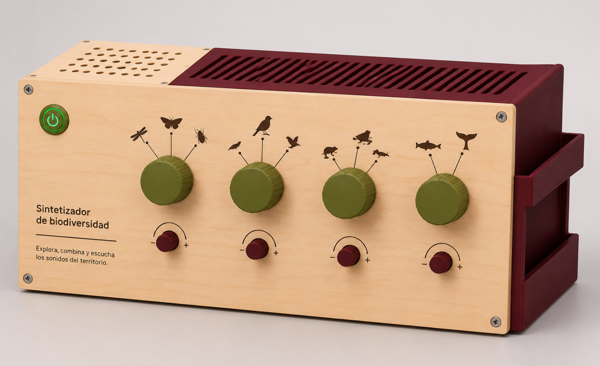
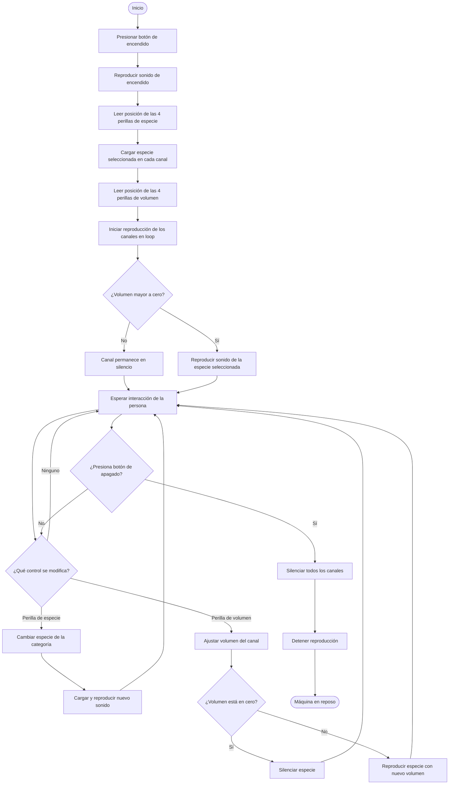
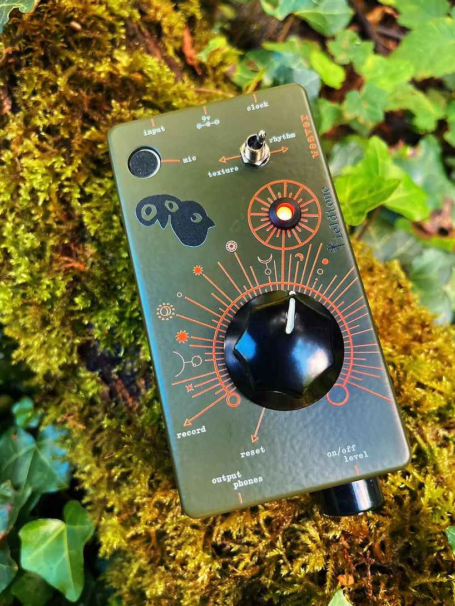

# grupo-03

## integrantes

- Magdalena Balart [_(magdalenabalart)_](https://github.com/disenoUDP/dis8645-2026-2-procesos-2/tree/main/02-magdalenabalart)
- Catalina Oyanedel [_(catalinaoyanedel-01)_](https://github.com/disenoUDP/dis8645-2026-2-procesos-2/tree/main/17-catalinaoyanedel-01)
- Yaira Ruiz [_(yairaruiz)_](https://github.com/disenoUDP/dis8645-2026-2-procesos-2/tree/main/26-yairaruiz)
- Marcela Zuñiga [_(marcezm)_](https://github.com/disenoUDP/dis8645-2026-2-procesos-2/tree/main/32-marcezm)

## sobre el proyecto

Este proyecto busca acercar y educar sobre la biodiversidad de las especies amenazadas o en peligro de extinción que habitan nuestro territorio chileno, a través de una máquina sonora que da visibilidad y amplifica sus voces y su existencia. Como consecuencia, apela desde la escucha, generar un vínculo sensible a la memoria de estas especies que muchas veces pasan desapercibidas, invitando a reconocer su presencia y reflexionar sobre la fragilidad de su existencia.. 

La máquina se organiza en cuatro categorías: mamíferos, aves, anfibios e insectos. Cada categoría contiene tres especies, una por cada zona del país (norte, centro y sur). 

La máquina permite escuchar, silenciar y superponer los sonidos de los distintos animales mediante perillas, generando composiciones sonoras que surgen de la combinación de sus voces. Así, el instrumento funciona tanto como un pequeño archivo de biodiversidad sonora como una herramienta de exploración y composición de un imaginario de paisaje sonoro.

### funcionamento

La máquina tendrá cuatro potenciómetros, uno por cada categoría: mamíferos, aves, insectos y anfibios. Cada uno tendrá la posibilidad de seleccionar uno de tres especies mediante rangos predefinidos. Cada uno de estos potenciómetros estará acompañado de otro potenciómetro que controlará la probabilidad de aparición del sonido. Cada vez que una especie suene, su velocidad, duración y volumen variarán aleatoriamente.

Un noveno potenciómetro controlará el tempo general, definiendo cada cuánto se evalúan estas probabilidades. Además, habrá un botón de encendido y apagado que emitirá un sonido para indicar el estado de la máquina.

**Boceto de la máquina:**



**Render hecho con Chat GPT:**

Prompt:

> "Genera un render realista del diseño que adjunto, respetando su distribución y proporciones. Los materiales y elementos deben interpretarse de la siguiente manera: las superficies de color café claro corresponden a madera clara; las piezas burdeos, a filamento de impresión 3D; y las perillas verdes, también a filamento 3D. Los pequeños puntos burdeos corresponden a potenciómetros de menor tamaño, destinados a controlar el volumen de cada especie. Las líneas grabadas en la superficie representan las siluetas de distintas especies. En la parte superior se encuentran los orificios de salida del sonido. El botón ubicado en la esquina superior izquierda corresponde al encendido y apagado del dispositivo, mientras que en la zona inferior izquierda se incorpora una pequeña leyenda explicativa. Es importante mantener la estética, la distribución de los controles y la estructura del diseño original, sin agregar elementos que no estén contemplados."




Paso a paso:

- Encendido: la persona presiona el botón de la esquina superior, suena un sonido que indica que esta encendido.
- Lectura de controles: al terminar el sonido, la máquina lee la posición de las 4 perillas de especie y de las 4 perillas de volumen, carga la especie que marca cada perilla de especie.
- Inicio en silencio: si las perillas de volumen están al mínimo, no se oye nada y el paisaje sonoro parte desde el silencio.
- Activar una especie: la persona sube una perilla de volumen y esa especie aparece en el paisaje. Las 4 categorías (mamíferos, aves, anfibios, insectos) suenan en loop, así que al subir el volumen entran en sincronía con las demás.
- Cambiar de especie: al girar una perilla de especie, el canal cambia a otra especie de su categoría y se escucha directamente el nuevo sonido (si el volumen está arriba de cero). 
- Ajustar volumen: con cada perilla de volumen, la persona sube o baja el volumen de cada sonido, creando distintos ritmos, intensidades y relaciones entre sonidos.
- Silenciar una especie: al bajar una perilla de volumen a cero, esa especie desaparece del paisaje. Su ausencia transforma la composición y permite notar la importancia de cada voz.
- Componer: la persona combina, suma y quita voces libremente, construyendo y transformando el paisaje sonoro de forma activa.
- Apagado: al presionar de nuevo el botón, se silencian todos los canales y la máquina queda en reposo.

### diagrama de flujo



### BOM – Lista de materiales


| Código | Componente | Especificación | Cantidad | Precio unitario (CLP) | Subtotal (CLP) | Proveedor |
|---|---|---|---:|---:|---:|---|
| MUX-001 | Multiplexor | CD74HC4067 – 16 canales | 1 | $2.000 | $2.000 | [Afel](https://afel.cl/products/modulo-multiplexor-cd74hc4067) |
| SPK-001 | Parlante | 8 Ω – 1 W | 1 | $3.290 | $3.290 | [Mechatronic Store](https://www.mechatronicstore.cl/altavoz-8-ohm-1w/) |
| AMP-001 | Amplificador | MAX98357A – I2S Class-D Mono | 1 | $1.114 | $1.114 | [AliExpress](https://es.aliexpress.com/item/1005007629020891.html) |
| POT-001 | Potenciómetro | B100K – 100 kΩ | 8 | $500 | $4.000 | [Afel](https://afel.cl/products/potenciometro-100k-ohm) |
| CAB-001 | Cable Dupont | Macho-hembra (pack 20) | 1 pack | $1.000 | $1.000 | [Afel](https://afel.cl/products/pack-20-cables-de-conexion-macho-hembra) |
| CAB-002 | Cable Dupont | Hembra-hembra (pack 20) | 1 pack | $1.000 | $1.000 | [Afel](https://afel.cl/products/pack-20-cables-de-conexion-hembra-hembra) |
| CAB-003 | Cable Dupont | Macho-macho (pack 20) | 1 pack | $1.000 | $1.000 | [Afel](https://afel.cl/products/pack-20-cables-de-conexion-macho-macho) |
| BTN-001 | Botón | Táctil 12 × 12 × 7,3 mm | 1 | $100 | $100 | [Afel](https://afel.cl/products/boton-tactil-tapa-12x12x7-3-interruptor) |
| SD-001 | Módulo micro SD | Lector de tarjeta micro SD | 1 | $2.500 | $2.500 | [Afel](https://afel.cl/products/lector-micro-sd) |

### referentes



Queremos rescatar de este referente la carcasa e interfaz, para realizar gráficas en vinilo o grabado láser. Por ejemplo, con la perilla, utilizar las siluetas de las especies para indicar donde se encuentra el usuario, hacer que la interacción sea más fácil de entender y permita la exploración autónoma.

- [PercuSynth - GC Lab](https://youtube.com/shorts/DbD2s_9ED9s)
- [Proto-Synth V2.0 - GC Lab](https://youtube.com/shorts/6owidjx-n7g)

Estos son nuestros referentes sonoros, son sintetizadores de GC Lab, los cuales trabajan con la construcción de paisajes sonoros de ambientes naturales y pájaros.

### pseudocódigo

```cpp
// ============ DATOS ============

categorias = [mamiferos, aves, anfibios, insectos]
especiesPorCategoria = 3

// Un audio por especie (todos preparados para repetirse en loop)
audios[categoria][especie] = "mamiferos/huemul", "aves/...", etc.
sonidoEncendido = "sistema/encendido"
sonidoApagado = "sistema/apagado"

// Estado general
maquinaEncendida = falso

// Estado de cada categoría
para cada categoria:
    especieActual[categoria] = ninguna
    volumenActual[categoria] = 0


// ============ PROGRAMA PRINCIPAL ============

inicio:
    prepararMaquina()
    quedarEnReposo()

    repetir siempre:
        si botonEncendidoPresionado():
            si maquinaEncendida:
                apagarMaquina()
            sino:
                encenderMaquina()

        si maquinaEncendida:
            para cada categoria en categorias:
                revisarEspecie(categoria)
                revisarVolumen(categoria)


// ============ ENCENDIDO Y APAGADO ============

funcion encenderMaquina():
    maquinaEncendida = verdadero
    reproducir(sonidoEncendido)
    esperarFinDelSonido()

    para cada categoria en categorias:
        especieActual[categoria] = ninguna
        volumenActual[categoria] = ninguno
        revisarEspecie(categoria)          // carga la especie que marca la perilla
        revisarVolumen(categoria)          // aplica el volumen que marca la perilla

funcion apagarMaquina():
    reproducir(sonidoApagado)
    esperarFinDelSonido()
    maquinaEncendida = falso
    quedarEnReposo()

funcion quedarEnReposo():
    para cada categoria en categorias:
        detenerSonido(categoria)
        fijarVolumen(categoria, 0)


// ============ CONTROLES ============

funcion revisarEspecie(categoria):
    posicion = leerPerillaEspecie(categoria)
    nuevaEspecie = convertirAEspecie(posicion, especiesPorCategoria)

    si nuevaEspecie es distinta de especieActual[categoria]:
        cambiarEspecie(categoria, nuevaEspecie)

funcion revisarVolumen(categoria):
    posicion = leerPerillaVolumen(categoria)
    nuevoVolumen = convertirAVolumen(posicion)       // de 0 a 100

    si nuevoVolumen es distinto de volumenActual[categoria]:
        volumenActual[categoria] = nuevoVolumen
        fijarVolumen(categoria, nuevoVolumen)


// ============ CAMBIO DE ESPECIE ============

funcion cambiarEspecie(categoria, nuevaEspecie):
    especieActual[categoria] = nuevaEspecie
    detenerSonido(categoria)
    cargarAudio(categoria, audios[categoria][nuevaEspecie])
    reproducirEnLoop(categoria)                      // siempre suena, el volumen decide si se oye
    fijarVolumen(categoria, volumenActual[categoria])
```

### wokwi
El simulador se trabajó con IA para hacer pruebas de las conexiones que necesitabamos.

Prompt:
> "Para este examen vamos a trabajar con C++. Necesito desarrollar un código de prueba para controlar 8 potenciómetros y un botón de encendido/apagado. Los primeros 4 potenciómetros serán para seleccionar especies. Cada uno tendrá 3 rangos de valores, correspondientes a Especie 01, Especie 02 y Especie 03, dependiendo de cuánto se gire. Los otros 4 potenciómetros controlarán el volumen de cada uno de los selectores, de forma independiente. Además, necesitamos un botón que permita encender y apagar todo el sistema, deteniendo la reproducción de los sonidos cuando esté apagado. La idea es probar primero esta lógica de funcionamiento en C++, utilizando sonidos de prueba y dejando el código preparado para integrar posteriormente los audios definitivos."

https://wokwi.com/projects/480943431055838209


