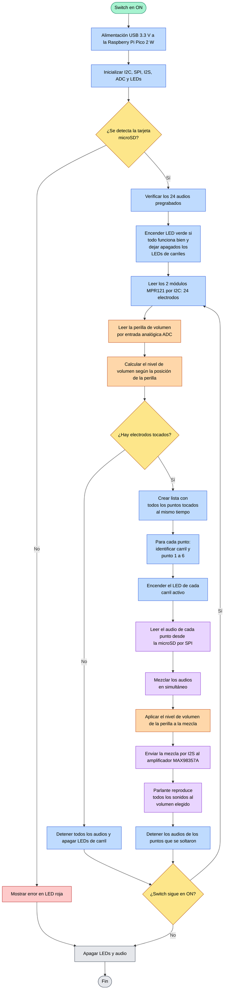
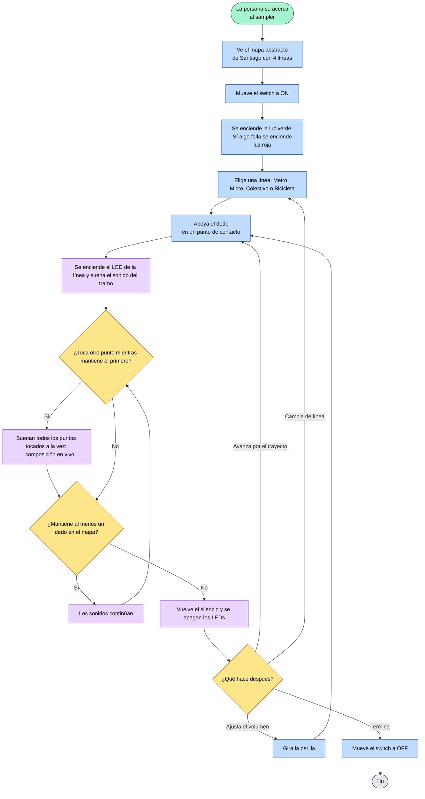

# Te escucho sonar, Santiago

**Realizado por:**  
*Francisca Jesús Palma Cuevas (frannciscapalma)*&nbsp;&nbsp;&nbsp;&nbsp;&nbsp;&nbsp;&nbsp;&nbsp;&nbsp;&nbsp;&nbsp;&nbsp;&nbsp;&nbsp;&nbsp;&nbsp;
*Nicolás Elías Valdés Greve (nicolasvaldesgreve)*&nbsp;&nbsp;&nbsp;&nbsp;&nbsp;&nbsp;&nbsp;&nbsp;&nbsp;&nbsp;&nbsp;&nbsp;&nbsp;&nbsp;&nbsp;&nbsp;
*Santiago Cifuentes Vélez (santiagocifuvelez)*&nbsp;&nbsp;&nbsp;&nbsp;&nbsp;&nbsp;&nbsp;&nbsp;&nbsp;&nbsp;&nbsp;&nbsp;&nbsp;&nbsp;&nbsp;&nbsp;
*Tomás Antonio Catrileo Curihual (tomascatri)*&nbsp;&nbsp;&nbsp;&nbsp;&nbsp;&nbsp;&nbsp;&nbsp;&nbsp;&nbsp;&nbsp;&nbsp;&nbsp;&nbsp;&nbsp;&nbsp;

## Descripción del trabajo

Te escucho sonar Santiago, es un sampler físico tangible que permite recorrer acusticamente cuatro trayectos en los medios de transporte más comunes para les estudiantes universitarios, los cuales toman como punto de partida general el barrio universitario , específicamente la Universidad Diego Portales, hasta la casa de cada une de elles en la ciudad de Santiago de Chile.

Este proyecto nace desde la rutina que se crea en torno a los medios de transporte y nuestra convivencia del trazo que se vuelve huella en nuestro día a día cuando vamos de un lugar a otro. Tanto así que solemos anticipar sonidos en nuestras cabezas para adelantarnos,
"se inicia el cierre de puertas",
o el chillido del frenazo del metro cuando comienza a detenerse y, en vez de ser incómodo, es la antítesis de la felicidad de saber que es tu turno de ir a casa. 

(Lo mismo sucede con el transporte que usted tome).

Este proyecto también busca resaltar su concepto de cuna, el cual empieza con la _justicia acústica_, ya que no todos los trayectos suenan igual, el ruido de la ciudad se vive de forma distinta dependiendo de cómo y por dónde nos movamos. 

## ¿Cómo funciona este sampler?
Este instrumento contiene sonidos pregrabados de los recorridos que inician desde la universidad Diego Portales, hacia los hogares de cada integrante del grupo  (universidad-casa) que se representa en un mapa abstraído de Santiago de Chile con 4 líneas(4 integrantes = 4 líneas).

Cada línea tiene 6 puntos de contacto, en donde cada punto tiene un sonido grabado perteneciente a ese tramo del viaje. Al pasar la línea con el dedo, el sensor capacitivo detecta en qué punto está el contacto y reproduce el sonido, el cual dura mientras hay contacto y vuelve al silencio al soltar.

También, en el sampler se puede reproducir sonidos en simultáneo; 
Si quiero oprimir el punto 3 de la línea 1, y a la vez quiero oprimir el punto 6 de la línea 4, pueden sonar a la vez. Sí oprimo todos los puntos de todas las líneas, tiene el mismo efecto de escucha simultánea. Como una composición en vivo. 

**A manera de resumen:** 
1. El instrumento se compone de 4 líneas que representan el recorrido de cada integrante.
2. Cada línea tiene 6 sonidos pregrabados en coherencia con el transporte escogido.
3. Al pasar el dedo por encima de la línea siguiendo el recorrido, se pueden activar y escuchar los sonidos dependiendo de la ubicación del dedo. 
4. **Perilla 1 = Volumen**
Graduar el volumen del sampler.
5. **Switch = on/off**
Para encender o apagar la máquina.
6. 

## Características de diseño
1. 3.3 V
2. Fuente abierta
3. Bajo licencia del MIT
4. Lenguaje C++
5. Retroalimentación mediante LEDs

## Referente: 

**Stylophone:** 
Dispositivo en el cual el usuario interactúa con el instrumento mediante una herramienta conductora. El instrumento tiende al silencio, y solo se permite generar sonidos al hacer contacto con la interfaz del instrumento mediante la herramienta conductora, y deja de sonar cuando se separa de este.

agregar 9 más

## Registro sonoro

Cada integrante grabó su recorrido universidad-casa en un medio de transporte distinto:

1. Metro (Fran): Línea 1 y 5 Maipú-Repúlica
2. Micro (Nico): 210 y E07 La Florida-República
3. Colectivo (Tomás): Cerro Navia-República
4. Bicicleta (Santi): San Miguel-República

#### Criterios de grabación

Acordamos qué sonidos grabar:

| Sonido    | Metro     | Micro | Colectivo | Bicicleta |
| -------- | --------- | ----- | --------- | --------- |
| Sonido 1 | perro     | pájaros | sonidos de las llaves |  Reja de la casa al cerrarse para salir.         |
| Sonido 2 | torniquete| tintineo micro | hola se paga | La cadena de la bicicleta al pedalear.           |
| Sonido 3 | inicio metro | "permiso"s | radio sonando | La respiración agitada.           |
| Sonido 4 | vendedores   ambulantes | cantante micro   (en su defecto,   alguien predicando) | direccionales sonando  |Tomar agua.           |
| Sonido 5 | Estación Central| sonido motor micro (ayuda) | se sube un pasajero   |Los autos en la avenida.           |
| Sonido 6 | Permisooo| "la puertaa" |  adios y gracias  | Clic del seguro del parking de la bicicleta |

---

## Bill of materials

| Componente | Cantidad | Valor unitario | Link |
| --- | ---: | ---: | --- |
| Raspberry Pi Pico 2 W con pines soldados | 1 | $14.990 | [Raspberry Pi Chile](https://raspberrypi.cl/products/raspberry-pi-pico-2-w-con-headers) |
| Módulo táctil capacitivo MPR121 de 12 entradas | 2 | $2.680 | [MechatronicStore](https://www.mechatronicstore.cl/modulo-controlador-de-sensor-tactil-capacitivo-teclado-i2c-mpr121/) |
| Protoboard MB-102 de 830 puntos | 1 | $2.500 | [Afel](https://afel.cl/products/protoboard-mb-102-830-puntos) |
| Interruptor MTS-102 de 3 pines | 1 | $400 | [Afel](https://afel.cl/products/interruptor-mts-102-3-pines) |
| LED de 5 mm, uno azul, amarillo, naranjo y morado para los carriles, más uno verde de encendido y rojo de error | 6 | $100 | [MechatronicStore](https://www.mechatronicstore.cl/led-alto-brillo-5mm-colores/) |
| 1 pack de 5 Resistencias de 470 Ω para los LED | 1 | $500 | [Triacs](https://triacs.cl/lamborghino/953-resistencia-470-ohm-12w-5-unid-.html) |
| Pack 10 cables caimán a Dupont macho | 1 | $2.500 | [Afel](https://afel.cl/products/kit-10-cables-caiman-a-dupont-macho) |
| 1 pack de 5 cables Dupont macho a macho | 1 | $1.000 | [Afel](https://afel.cl/products/pack-20-cables-de-conexion-macho-macho) |
| Cable USB a Micro USB de datos para alimentar y programar la Pico | 1 | $1.000 | [Afel](https://afel.cl/products/cable-micro-usb-30cm) |
| Parlante de 8 Ω y 1 W | 1 | $3.290 | [MechatronicStore](https://www.mechatronicstore.cl/altavoz-8-ohm-1w/) |
| Amplificador de audio I²S MAX98357A | 1 | $4.236 | [Mercado Libre](https://www.mercadolibre.cl/modulo-amplificador-audio-i2s-3w-clase-d-/p/MLC2069999027?pdp_filters=item_id%3AMLC4487218772) |
| Módulo Lector Micro SD SPI | 1 | $2.900 | [MechatroniStore](https://www.mechatronicstore.cl/modulo-lector-micro-sd-spi/) |

---

## Flowchart sampler: 
Te escucho sonar, Santiago

## Flowchart sampler: 
Te escucho sonar, Santiago

## Flowchart: experiencia de usuario

## Pseudocódigo

AL ENCENDER EL PANEL
    Encender la luz verde.
    Dejar apagadas las luces de los cuatro carriles.

MIENTRAS EL PANEL ESTÉ ENCENDIDO
    Revisar los 24 botones.

    Cuando alguien presione un botón:
        Encender la luz de su carril.
        Mostrar en la consola el número del botón, el carril y el momento del viaje.
        Ejemplo: Botón 3 | Carril Colectivo | Espera.

    Si alguien mantiene presionado el botón, el aviso aparece una sola vez.
    Si lo suelta y vuelve a presionarlo, aparece un nuevo aviso.

    Cuando se suelte el último botón presionado de un carril,
    apagar la luz de ese carril.

AL APAGAR EL PANEL
    Apagar todas las luces y dejar de registrar pulsaciones.

---

## Esqueleto en Wokwi 

En Wokwi, se creó un componente en simulación del sensor MPR121; cada botón en la simulación emite una señal que se manda a la consola simulando el sonido. Quisimos hacerlo así, ya que aún no tenemos los audios.

https://wokwi.com/projects/480903494879270913

---

## Case

## Fuentes

- <https://docs.sunfounder.com/projects/newton-lab-kit/en/latest/cproject/ar_mpr121.html> CONEXIONES DEL SENSOR
- <https://www.instructables.com/Stylobit-a-Microbit-Powered-Stylophone/> estilofono diy lego(? en caso de idk
- <https://learn.adafruit.com/adafruit-mpr121-12-key-capacitive-touch-sensor-breakout-tutorial?view=all> 
