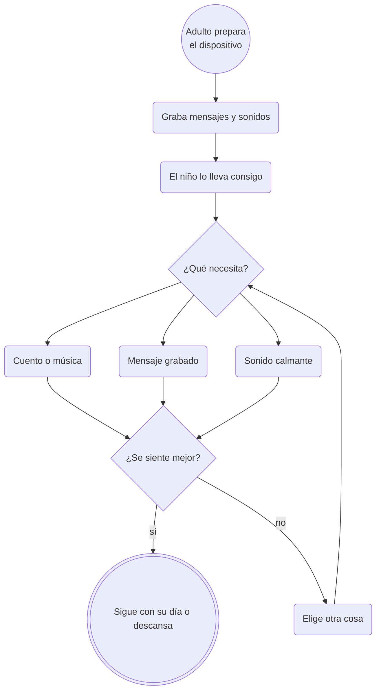

# grupo-07

### Integrantes

- Isidora Díaz [@isiidoraadiiaz](https://github.com/isiidoraadiiaz)
- Natalia Gutiérrez [@blosssom-n](https://github.com/blosssom-n)
- Carlo Martínez [@zaaaiko](https://github.com/zaaaiko)
- Natalia Pilar [@sz-mada](https://github.com/sz-mada)

## Descripción del proyecto

### Descripción general

El proyecto consiste en un dispositivo sonoro portátil diseñado para acompañar a niños de 3 a 4 años que necesiten apoyo en momentos de soledad, miedo o incertidumbre. El dispositivo permitirá reproducir cuentos, música y mensajes grabados por un cuidador mediante una interacción física sencilla. El nombre del dispositivo y del proyecto aún está por definir.

### Usuario objetivo y contenido

El público objetivo corresponde a niños de 3 a 4 años que necesiten acompañamiento. Se trabajará con una biblioteca común y no con bibliotecas separadas por rango de edad.

Los cuentos y la música utilizarán audios con licencias que permitan su uso. La biblioteca inicial será cerrada y estará compuesta por los contenidos definidos por el equipo. Las grabaciones serán el único contenido proporcionado directamente por el cuidador y se actualizarán diariamente.

La biblioteca se organizará según dos momentos del día, día y noche. Aún debe definirse cómo el dispositivo reconocerá cada momento, por ejemplo mediante la hora de Santiago, un temporizador o una configuración realizada por el cuidador.

### Funcionamiento principal

El dispositivo principal será utilizado por el niño y contará con tres botones físicos duros asociados a cuentos, música y grabaciones.

La primera presión activará la categoría correspondiente. Una nueva presión sobre el mismo botón permitirá cambiar el contenido dentro de esa categoría. El sistema deberá evitar la reproducción repetida del mismo audio y diferenciar entre una pulsación válida, una pulsación larga y varias pulsaciones consecutivas.

La pantalla acompañará la interacción, aunque todavía debe definirse qué información mostrará. Entre las posibilidades se encuentran la categoría activa, el personaje asociado al contenido, el audio en reproducción y el estado del dispositivo.

### Sistema de grabación

El sistema permitirá almacenar un solo mensaje familiar a la vez. El mensaje se eliminará después de un día o será reemplazado cuando se registre uno nuevo. La grabación estará destinada al cuidador y no al uso cotidiano del niño.

### Alternativas consideradas

La primera alternativa consistía en utilizar una perilla encoder con un rango mínimo y máximo asociado a no y sí. Si el dispositivo no estaba ejecutando otra acción, después de 15 segundos volvería al valor por defecto, no. Para comenzar la grabación se debería seleccionar sí y mantener la perilla presionada durante cinco segundos. La pantalla mostraría una cuenta regresiva hasta indicar grabando. Al soltar la perilla terminaría la grabación y aparecería durante diez segundos el “mensaje guardado”. También se consideró que una nueva presión pudiera eliminar el mensaje anterior.

La segunda alternativa consistía en utilizar la pantalla touch con lápiz como control parental. Un ícono ubicado en una esquina de la pantalla debería mantenerse presionado durante cinco segundos para acceder a una pantalla de clave. Desde allí se podría crear o modificar la clave y luego acceder a la grabación. Esta opción requería comprobar si era posible utilizar solo una sección de la pantalla como superficie touch y si el lápiz funcionaría correctamente.

### Alternativa seleccionada

La alternativa seleccionada consiste en separar físicamente una parte del dispositivo principal. Este módulo incluirá el micrófono y la función de grabación, y se conectará mediante conectores JST. Al conectarlo aparecerá la interfaz de grabación.

El cuidador presionará el módulo para comenzar a grabar y lo soltará para terminar. Al finalizar aparecerá el “mensaje guardado”. Si se produce un error, se mostrará una notificación correspondiente. Un LED permanecerá encendido durante la grabación y se apagará al terminar.

El parlante y los botones de cuentos, música y grabaciones permanecerán en el dispositivo principal, que será utilizado por el niño. La separación del módulo funcionará como una restricción física para evitar que el niño acceda a la grabación o elimine accidentalmente los mensajes de sus cuidadores.

### Componentes y almacenamiento

Se utilizará un micrófono básico y de bajo costo. Falta seleccionar un modelo compatible con la raspi y comprobar si su conexión será mediante USB o una entrada analógica por ADC.

El almacenamiento se resolverá mediante un lector SD y una tarjeta SD, donde se guardarán los audios de la biblioteca y el mensaje diario del cuidador.

El amplificador PAM8403 y el parlante se mantienen como referencia para la salida de audio. Antes de cerrar el sistema será necesario probar la cadena de reproducción con la raspi.

### Carcasa

La carcasa debe integrar el dispositivo principal y el módulo desmontable. También debe contemplar espacio para la pantalla, el parlante, el lector SD, la tarjeta, la batería, los conectores JST y la ventilación.

Se utilizarán botones duros y diferenciables. No se utilizarán botones de goma. El módulo desmontable deberá poder separarse sin dejar conexiones expuestas ni piezas fáciles de retirar.

## Bill of Materials

| Componente | Cantidad | Precio unitario | Proveedor |
|---|---:|---:|---|
| Raspberry Pi Pico | 1 | $0 | Universidad |
| Pantalla TFT LCD Touch 2,4" SPI | 1 | $10.000 | Afel |
| Mini parlante 3 W / 4 Ω | 1 | $3.000 | Afel |
| Amplificador PAM8403 2x3 W | 1 | $1.000 | Afel |
| Kit de 5 botones pulsadores | 1 | $500 | Afel |
| Micrófono USB pequeño | 1 | $4.000 | Por definir |
| Tarjeta microSD 32 GB | 1 | $6.000 | Por definir |
| Power Bank USB-C (5 V / 3 A) | 1 | $15.000 | Por definir |
| Cable USB-C de alimentación | 1 | $1.500 | Por definir |
| Cable y conexión de audio 3,5 mm | 1 | $1.500 | Por definir |
| Cables Dupont y conectores | 1 lote | $2.500 | Afel / estimado |
| Carcasa impresa en 3D | 1 | $6.000 | Fabricación propia |
| **TOTAL ESTIMADO** | | **$51.000** | |

*Precios en pesos chilenos (CLP). Los valores de pantalla, parlante, amplificador y pulsadores corresponden a precios publicados en Afel. Los demás son estimaciones presupuestarias y deben confirmarse antes de la compra.*

### Enlaces de componentes — Afel

- [Pantalla TFT LCD Touch 2,4"](https://afel.cl/products/2-4-inch-spi-touch-screen-module-tft-interface-240-320-with-touch)
- [Mini parlante 3 W](https://afel.cl/products/mini-parlante-altavoz-de-3w)
- [Amplificador PAM8403](https://afel.cl/products/amplificador-stereo-clase-d-2x3w-pam8403)
- [Kit de 5 botones pulsadores](https://afel.cl/products/kit-boton-tactil-6x6x10-de-4-pines-interruptor-5-unidades)
- [Cables y conectores](https://afel.cl/collections/cables)

### Función de los componentes

- **Raspberry Pi Pico:** controla el funcionamiento del dispositivo, la pantalla, los botones y el sistema de reproducción y grabación de audio.

- **Pantalla TFT LCD:** muestra ilustraciones, personajes, cuentos, categorías de contenido y opciones de navegación.

- **Mini parlante:** reproduce cuentos, música, sonidos relajantes y mensajes familiares.

- **Amplificador PAM8403:** amplifica la señal de audio de la Raspberry Pi para alimentar el parlante.

- **Botones pulsadores:** permiten navegar por las categorías, seleccionar audios, reproducir, pausar y activar la grabación de voz.

- **Micrófono USB:** permite grabar mensajes personalizados de familiares o cuidadores.

- **Tarjeta microSD:** almacena el sistema operativo, el programa, los cuentos, la música y las grabaciones.

- **Power Bank:** proporciona energía portátil al dispositivo. Debe entregar 5 V / 3 A de forma estable.

- **Cable USB-C:** conecta la Power Bank con la raspberry pi pico.

- **Conexión de audio:** transporta el audio desde la Raspberry Pi hacia el amplificador.

- **Cables y conectores:** permiten realizar las conexiones electrónicas entre los componentes.

- **Carcasa impresa en 3D:** protege los componentes y permite desarrollar una forma redondeada, cómoda y fácil de manipular.

### Presupuesto final

Costo estimado por dispositivo: **$51.000 CLP**

El presupuesto considera la reutilización de una Raspberry Pi Pico disponible en la universidad.

## Diagrama de flujo



## Pseudocódigo

```cpp
// PROYECTO 3 — CÓDIGO 1
// Primero definimos las entradas, los estados y lo que debería pasar en cada caso.
//
// 0. PREPARAR LAS ENTRADAS
// Vamos a leer tres botones, uno para cuentos, otro para música y otro para grabaciones.
// También tenemos que leer el módulo separado de grabación, el micrófono y el estado del lector SD.
// La pantalla, el parlante, el PAM8403 y el LED de grabación quedan como salidas.
// Los pines todavía no los escribimos hasta probar el diagrama y el cableado.
//
// 1. PREPARAR LOS ARCHIVOS Y VARIABLES
// En la tarjeta SD vamos a tener los cuentos, la música y el mensaje del cuidador.
// El mensaje del cuidador se guarda como un solo archivo.
// Si se graba otro mensaje, reemplaza al anterior.
// Después de un día el mensaje se borra.
// Necesitamos guardar qué audio está sonando y cuál fue el último, para no repetirlo todo el rato.
// También necesitamos guardar la categoría actual y el estado de reproducción.
//
// 2. LEER EL MOMENTO DEL DÍA
// El contenido se separa entre día y noche.
// Falta decidir si la hora se obtiene desde la raspi o si usamos un temporizador.
// La función debería devolver día o noche y actualizar la biblioteca que se muestra.
//
// 3. LEER LOS BOTONES
// La primera presión activa una categoría.
// Otra presión sobre el mismo botón cambia al siguiente contenido de esa categoría.
// Hay que diferenciar una presión corta de una presión larga.
// Varias presiones muy seguidas no deberían cambiar muchas veces el contenido.
// Para eso necesitamos guardar el estado anterior del botón y el tiempo de la última presión.
//
// 4. LEER EL MÓDULO DE GRABACIÓN
// Cuando el módulo está conectado, se puede entrar al estado de grabación.
// Al presionar comienza la grabación y al soltar termina.
// Mientras está grabando prendemos el LED.
// Al terminar guardamos el archivo y mostramos “mensaje guardado”.
// Si no está el micrófono o falla la tarjeta SD, mostramos un error.
// Cuando el módulo se separa, volvemos al dispositivo principal.
//
// 5. PREPARAR LA PANTALLA
// La pantalla debería mostrar la categoría, el audio actual y el estado del dispositivo.
// También debería mostrar grabando, mensaje guardado y error.
// La pantalla todavía está por definir, así que por ahora dejamos esas funciones separadas.
//
// 6. ESTADOS DEL PROGRAMA
// Por ahora necesitamos espera, navegación, reproducción, grabación, mensaje guardado y error.
// El estado actual decide qué entradas se leen y qué se muestra.
// No debería sonar un audio mientras estamos guardando otro archivo.
//
// 7. ORDEN DEL CICLO PRINCIPAL
// Primero iniciamos la raspi, la pantalla, el audio, la tarjeta SD y los botones.
// Después leemos las entradas.
// Luego decidimos si cambió la categoría, si hay que reproducir, grabar o mostrar un error.
// Actualizamos la pantalla y las salidas.
// Repetimos el ciclo sin bloquearlo con esperas largas.
// Para medir tiempos podemos usar una marca de tiempo, como time_us_64.
//
// 8. REVISAR RESULTADOS
// Probamos un botón a la vez y comprobamos que los otros no cambien.
// Probamos leer un cuento y una canción desde la tarjeta SD.
// Probamos que no se repita el mismo archivo inmediatamente.
// Probamos grabar, guardar, reemplazar y borrar el mensaje del cuidador.
// Probamos el LED, el mensaje guardado y el mensaje de error.
// Probamos el cambio entre día y noche cuando definamos cómo se obtiene la hora.
```
