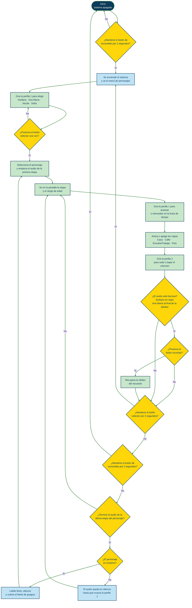

# sesion-14a

## apuntes sesión

## 🔀 Diagramas de flujo

<details>
<summary><b>Mapa de flujo: experiencia de usuario</b></summary>



</details>

<details>
<summary><b>Mapa de flujo: máquina</b></summary>

```mermaid
%%{init: {'theme':'base','themeVariables':{'fontFamily':'Arial','lineColor':'#2E7D32','primaryTextColor':'#0B3C5D'}}}%%
flowchart TD
    A([Alimentación del sistema]) --> B["Inicializar pantalla OLED,<br/>reproductor MP3, botones y perillas<br/>estado = APAGADO"]
    B --> C{"¿Botón de encendido<br/>mantenido 2 s?"}
    C -- No --> C
    C -- Sí --> D["estado = MENÚ<br/>Mostrar personajes en pantalla"]

    D --> E["Leer perilla 1<br/>Dividir en 4 rangos<br/>Giuliano · Ana María · Nicole · Sofía"]
    E --> F{"¿Botón selector<br/>toque corto?"}
    F -- No --> E
    F -- Sí --> G["Confirmar personaje<br/>Cargar sus etapas y audios<br/>estado = REPRODUCIENDO"]

    G --> H["Leer perilla 1<br/>Dividir en 7 etapas"]
    H --> I{"¿El personaje tiene<br/>esa etapa?"}
    I -- No --> J["Detener audio<br/>Mostrar etapa sin audio"]
    I -- Sí --> K["Reproducir audio de la etapa<br/>Mostrar rango de edad y nombre"]
    J --> L
    K --> L["Leer

## encargos

## lectura
