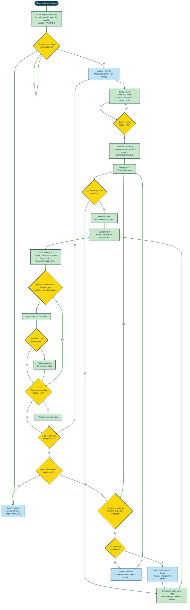
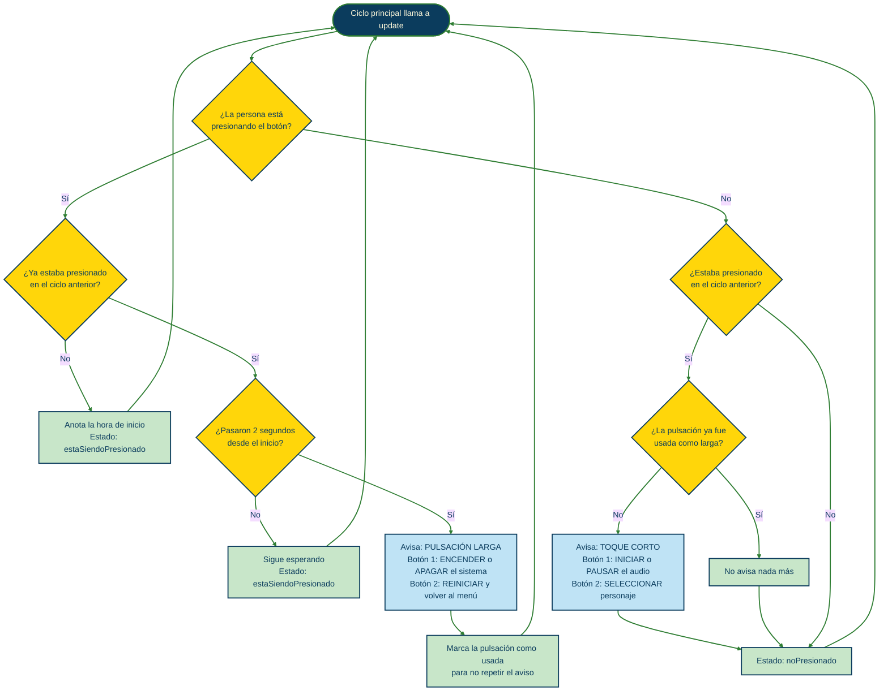
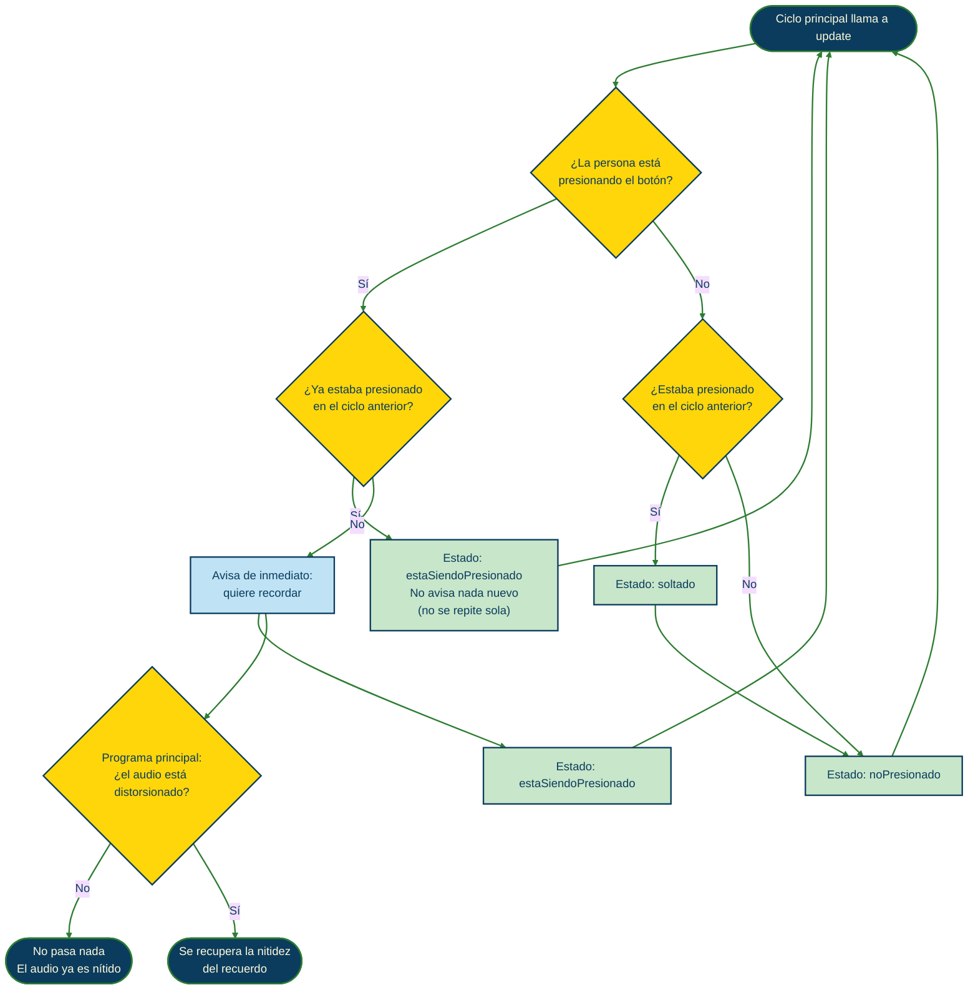
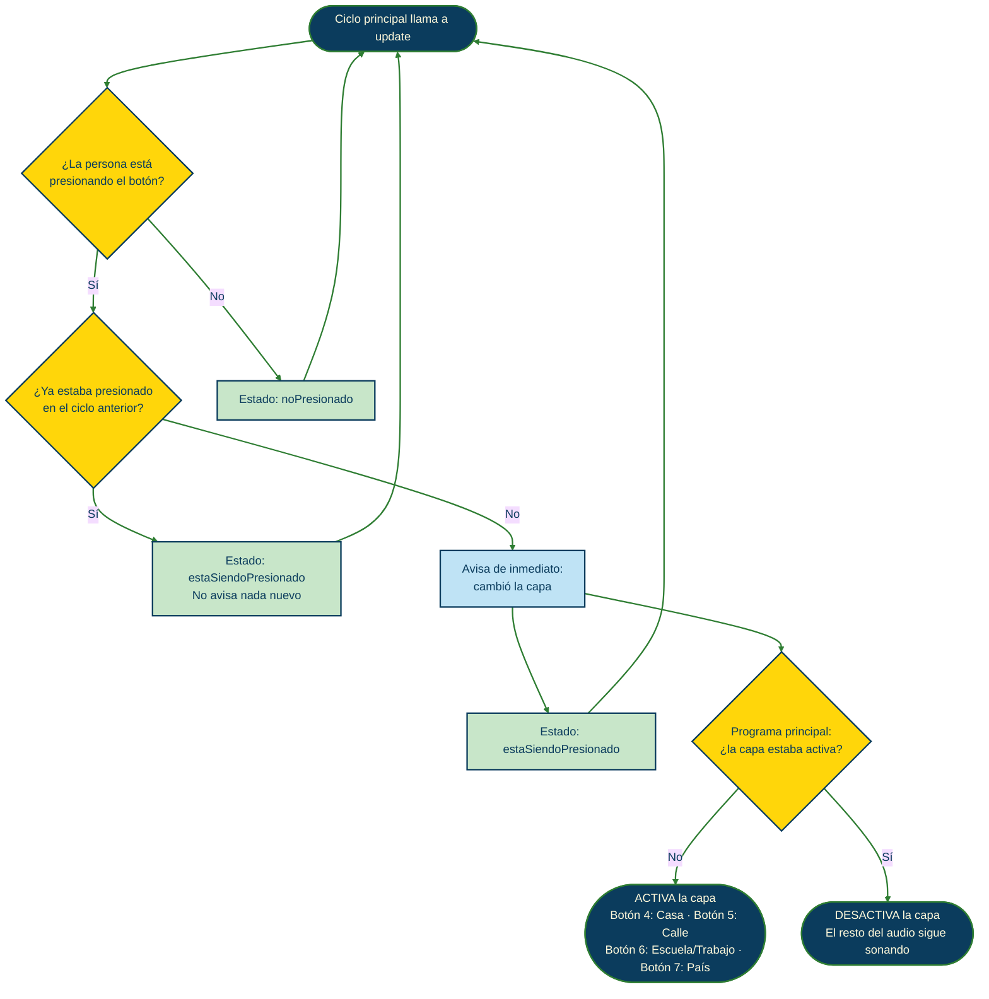
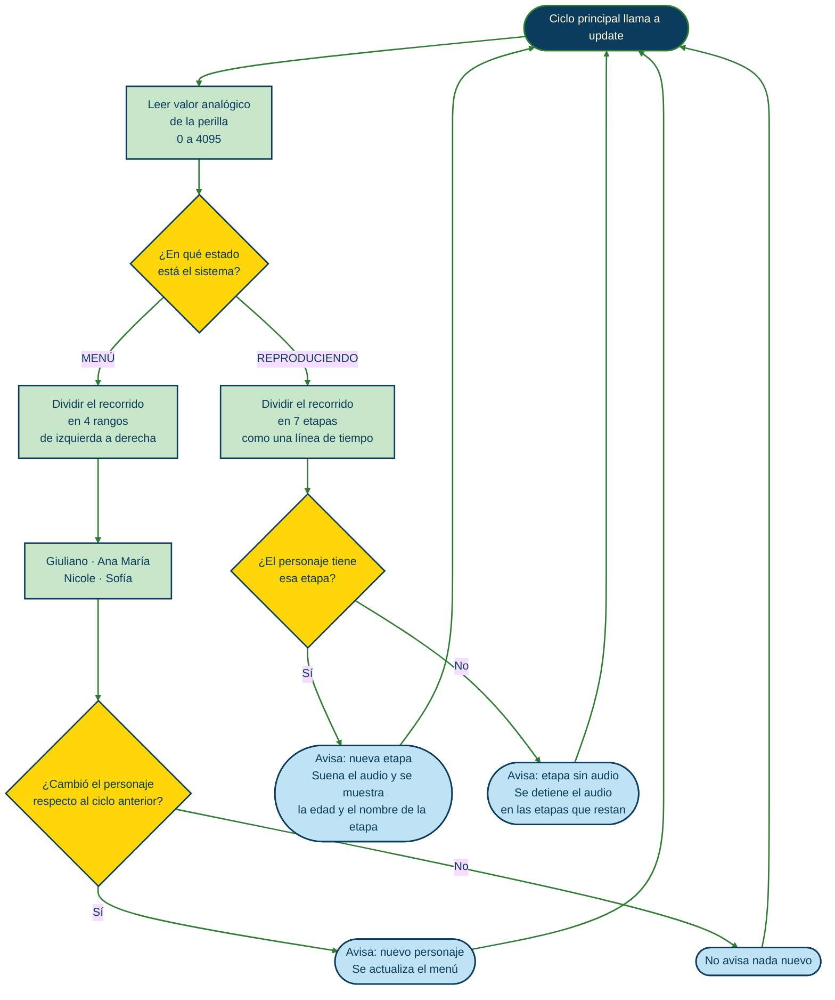
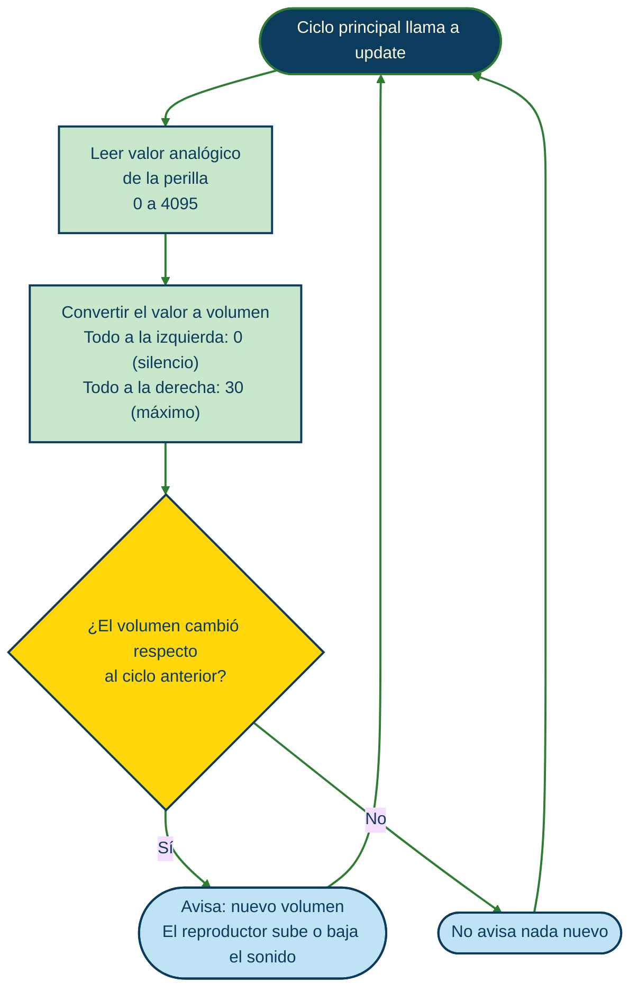

# sesion-14a

## apuntes sesión

## 🔀 Diagramas de flujo

<b>Mapa de flujo: experiencia de usuario</b>

<b>Mapa de flujo: máquina</b>

<b>Diagrama de flujo: botones</b>

**Botones 1 y 2 (encendido y selector):** ambos distinguen entre un toque corto y una pulsación larga de 2 segundos.

**Botón 3 (recordar):** recupera la nitidez solo cuando el audio está distorsionado.

**Botones 4 a 7 (capas):** cada botón activa su capa con un toque y la desactiva con el siguiente.

<b>Diagrama de flujo: perillas</b>

**Perilla 1 (personajes y línea de tiempo):** su función depende del estado del sistema.

**Perilla 2 (volumen):** funciona igual que el volumen de una radio.

