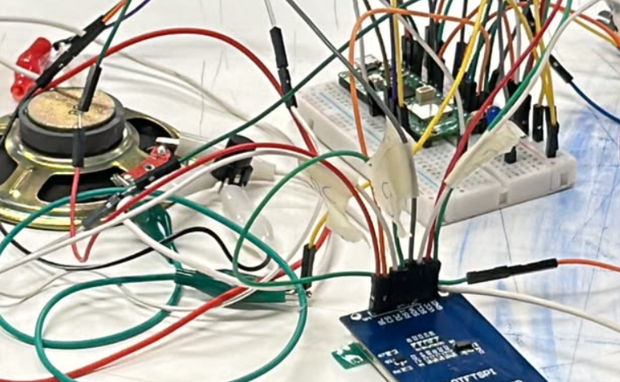
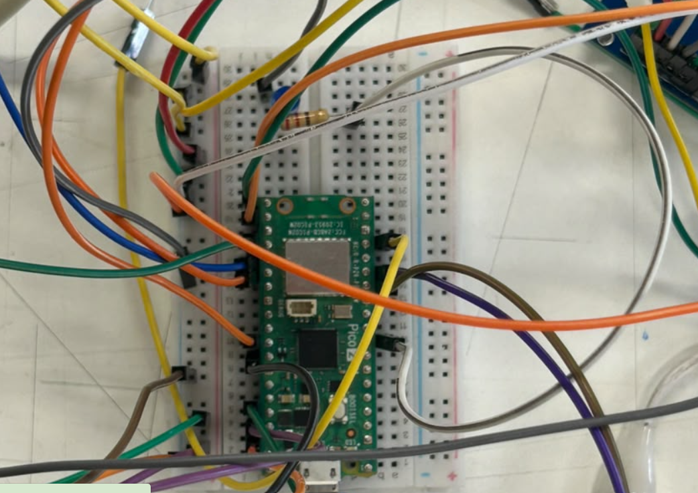

# sesion-11b

## apuntes sesión

durante esta jornada, el trabajo fue principalmente manual, ya que comenzamos a montar nuestro proyecto físicamente, integrando la raspberry y todos sus componentes. durante el proceso, tuvimos algunas complicaciones con la pantalla, ya que no encendía. después de revisar varias veces, nos dimos cuenta de que una de sus patitas estaba fallando y que debía mantenerse en una posición específica para funcionar correctamente.

además, tuvimos problemas con las conexiones, ya que la raspberry no daba señales de vida. por esta razón, decidimos desmontar todo y comenzar nuevamente desde cero, conectando los componentes por partes y comprobando su funcionamiento uno a uno hasta encontrar la configuración correcta.

finalmente, logramos que todo funcionara y pudimos armar nuestra cajita, encajando los componentes en sus respectivos lugares. fue un momento de mucha alegría y alivio, especialmente después de todo el estrés y la frustración que nos acompañaron durante el proceso. ¡después de varios intentos y de casi arrancarnos los pelos, por fin lo conseguimos! :)

