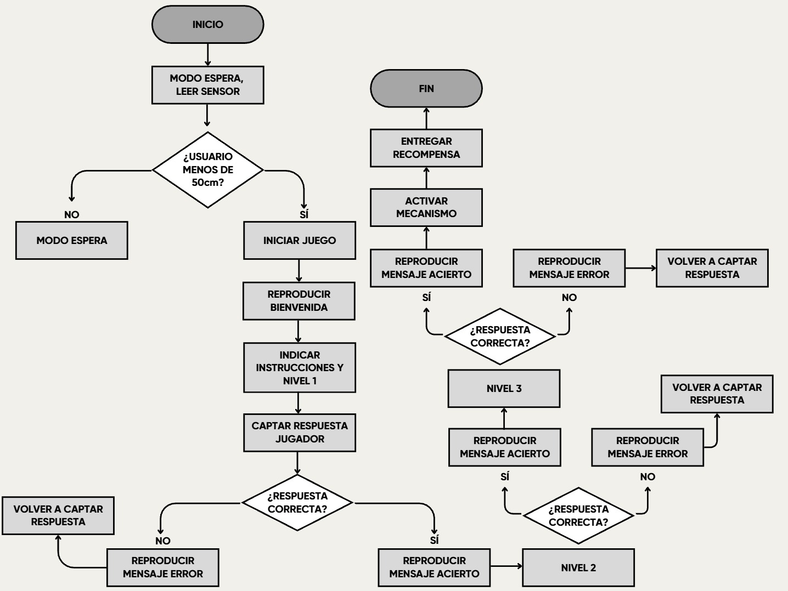

# sesion-13a

## apuntes sesión

se revisó la calendarización de las próximas clases y entregas.

durante la clase se trabajará principalmente en los aspectos visuales del proyecto, definiendo qué queremos realizar y desarrollando una descripción de nuestra propuesta.

### brainstorming

**sí**
1. que sea chistoso.
2. que tenga un componente sentimental.
3. que incorpore muchas luces led.
4. que utilice sensores.
5. que incluya sonido, música o voz.
6. que sea colorido y tenga una estética poco convencional.
7. que incorpore una pantalla.
8. que sea interactivo y permita la interacción táctil.
9. que tenga muchos botones.
10. que utilice materiales como impresión 3d y acrílico.
11. que incorpore algún tipo de mecanismo.

**no**
1. que tenga una temática seria.
2. que sea convencional.
3. que hable de manera autónoma, sin interacción.
4. que utilice perillas.
5. que esté construido con cartón.
6. que tenga contenido grosero.
7. que sea demasiado pequeño.
8. que sea transparente.
9. que se desplace por sí solo de su lugar.
10. que tenga una estructura abierta.
11. que permita la interacción de varias personas al mismo tiempo.
12. que supere los $50.000 de presupuesto total entre todos los integrantes.

### calendarización

**13a:**
- tabla de materiales.
- texto con la descripción de las propuestas de proyecto.
- diagrama de flujo.
- presentar dos propuestas adicionales.

**13b:**
- descripción completa del proyecto.
- prototipos.
- pseudocódigo.
- simulación en wokwi.

**14a:**

**14b:**
- entrega proyecto 03.

### descripción proyecto

**ideas iniciales**
- una cajita que entregue un regalo.
- un juego para adivinar canciones.

el proyecto consiste en una rocola interactiva que permite reproducir fragmentos musicales y controlar su funcionamiento mediante comandos de voz. está desarrollada a partir de un sistema que utiliza una raspberry pi pico 2 w, programada en c++.

físicamente, tendrá la apariencia de una caja con estética retro, inspirada en las antiguas rocolas. el dispositivo permanecerá en estado de reposo hasta que un sensor ultrasónico detecte la aproximación de un usuario a una distancia menor a 50 cm. una vez activado, el sistema funcionará mediante una interfaz controlada por voz.

para esto, un módulo de hardware dfplayer mini será el encargado de reproducir instrucciones pregrabadas desde una tarjeta microsd, además de emitir fragmentos de canciones correspondientes a cada uno de los tres niveles del desafío. el usuario deberá responder en voz alta, mientras un módulo de reconocimiento de voz captará su respuesta para que el microcontrolador pueda validarla.

dependiendo del resultado, el sistema entregará una respuesta auditiva indicando si la persona acertó o falló. finalmente, si el jugador logra completar correctamente los tres niveles consecutivos utilizando únicamente comandos de voz, la máquina de estados finitos que controla el funcionamiento del sistema enviará una señal pwm a un servomotor oculto. este activará un mecanismo que liberará una compuerta y permitirá la entrega física de un premio.

### BOM

|Componente|Cantidad|Precio|Link|
|---|---|---|---|
|Raspberry Pi Pico|1|$14.990|<https://raspberrypi.cl/products/raspberry-pi-pico-2-w-con-headers>|
|Reproductor de Audio (DFPlayer Mini)|1|$2.990|<https://afel.cl/products/modulo-reproductor-mp3-tf-16p-v3-0>|
|Salida de Audio (Altavoz 3W, 8 Ohm)|1|$3.000|<https://afel.cl/products/mini-parlante-altavoz-de-3w>|
|Sensor de Proximidad (HC-SR04)|1|$1.500|<https://afel.cl/products/sensor-de-ultrasonico-hc-sr04>|
|Micro Servo SG90|1|$1.990|<https://afel.cl/products/micro-servomotor-sg90>|
|Entrada de Voz (Módulo Offline o Micrófono I2S)|1|$x|x|
|Protoboard|1|$1.500|<https://afel.cl/products/mini-protoboard-400-puntos>|
|Cables dupont pack 20|x|$1.000|<https://afel.cl/products/pack-20-cables-de-conexion-macho-macho>|
|Kit 10 Cables Caiman a Dupont Hembra|x|$2.500|<https://afel.cl/products/kit-10-cables-de-conexion-macho-a-dupont-hembra?_pos=2&_sid=aec538813&_ss=r>|
|Pack 20 Cables de Conexión Macho Hembra|x|$1.000|<https://afel.cl/products/pack-20-cables-de-conexion-macho-hembra?_pos=1&_sid=bff72fae6&_ss=r>|
|Potenciómetro B100k|1|$500|<https://afel.cl/products/potenciometro-10k-ohm>|
|Cable|1|$x|<https://www.masterg.cl/mgcamic/p?idsku=6>|
|Almacenamiento (Tarjeta MicroSD)|1|$x|x|
|Led|x|$x|x|

### diagrama flujo

- representación gráfica de los pasos de un proceso, organizados de manera secuencial.
- permite presentar información y apoyar el razonamiento.
- facilita la visualización de procesos complejos.
- permite que todos puedan comprender y revisar el trabajo de los demás.

**simbología:**

- **círculos/óvalos:** representan el inicio y el término del sistema.
- **cuadrados:** representan una operación o acción específica.
- **rombos:** representan decisiones o bifurcaciones dentro del proceso. Sus distintas salidas indican los posibles caminos o subprocesos que se pueden seguir.

referencia: <https://www.visual-paradigm.com/tutorials/flowchart-tutorial/>

**3 referentes de estudio para el viernes:**

- david byrne, *playing the building*: <https://en.wikipedia.org/wiki/Playing_the_Building>
- kelly dobson, *scream body*: <https://www.youtube.com/watch?v=Ta7rN5TeKzw>
- dato musical instruments: <https://dato.mu/>
- brian dewan.
- boss fight books: <https://bossfightbooks.com/>

## lectura

páginas leídas:  80 a la 90

en estas páginas se menciona el comercial de televisión de apple de 1984 y la llegada de la macintosh, usándolos para mostrar cómo se creó una narrativa de "liberación" frente a un supuesto monopolio opresor, cuando en realidad lo que hacían era imponer una ideología de control estético y técnico. también el salto hacia atrás en la historia de los medios para analizar la poesía concreta hecha con máquinas de escribir en los años 60 y 70 por autores como bpnichol y steve mccaffery, demostrando que la máquina de escribir misma era una interfaz que obligaba a experimentar con la materialidad del texto y del soporte. 

cita 1 

“Hemos creado por primera vez en toda la historia un jardín de pura ideología, donde cada trabajador puede florecer, a salvo de las plagas de cualquier pensamiento verdadero contradictorio. Nuestra unificación de Pensamientos es más poderosa que cualquier flota o ejército en la tierra. Somos un pueblo, con una sola voluntad, una sola resolución, una sola causa. Nuestros enemigos se hablarán a sí mismos hasta la muerte, y los enterraremos con su propia confusión.”(Emerson, p.82)

cita 2 

“La máquina de escribir surge como una interfaz de lectura/escritura analógica profundamente influyente. Además, la poesía de máquina de escribir en general y la poesía concreta sucia en particular son sumamente eficaces en la forma en que llaman la atención sobre los límites y las posibilidades de la máquina de escribir como interfaz.”(Emerson, p.88) 

