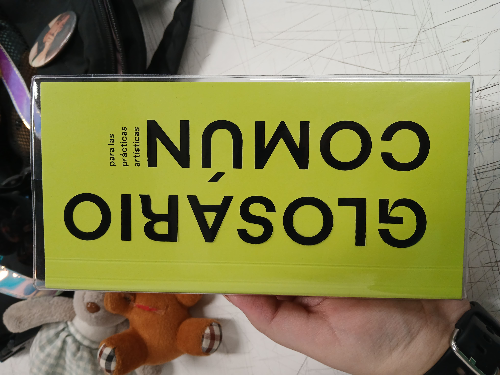
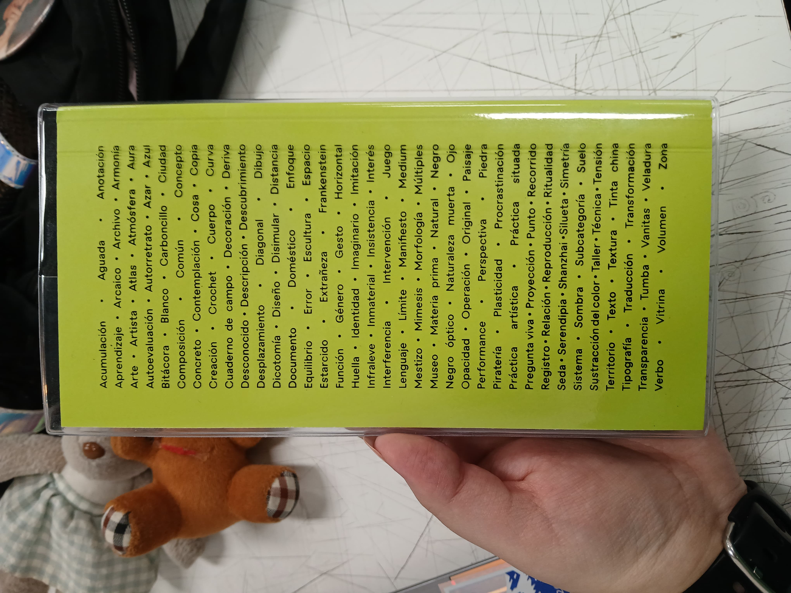
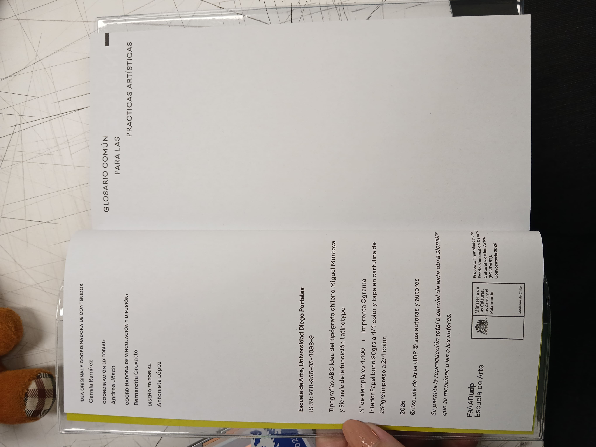
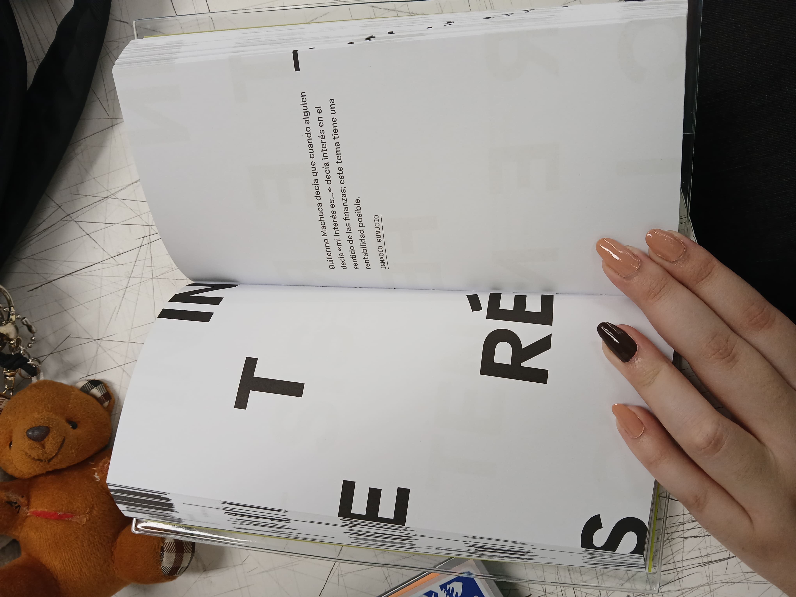

# sesion-13b

2026.11.13

## apuntes sesión

Aarón nos contó que por los 20? años de la escuela de Arte en la UDP, van a regalar? entregar? (I can't recall lol) copias de un glosario









---

Comenzamos revisando los avances de cada grupo (not really, we skipped over some lol)

- Revisamos al [Grupo 01](https://github.com/sz-mada/dis8645-2026-2-procesos-2/tree/main/29-biankavilchez/sesion-13a/README.md)

Autotune: measures and corrects pitch in recorded or live human vocals and instruments

- Revisamos al [Grupo 07](https://github.com/sz-mada/dis8645-2026-2-procesos-2/tree/main/10-blosssom-n/sesion-13a/README.md) (el nuestro jiji)

Fan Connect no solo es muy ambicioso, pero no sabemos how to approach los derechos de autor, Aarón habló del juego de mesa "HITSTER" como idea (en las cartas/tarjetas, hay un escaneable que lleva a Spotify)

Si voy a diseño abierto solo, cómo interactúo con el dispositivo? :thinking:

Nido se ve más viable, de hecho, le gustó mucho a Aarón

Nido as a name is :x: OUT :x:, tanto porque ya es un nombre corp. que ya existe, como por you know... nido/.org

- Revisamos al [Grupo 05](https://github.com/sz-mada/dis8645-2026-2-procesos-2/tree/main/05-santiagocifuvelez/sesion-13a/README.md)

<https://www.clubsonorodeportivo.cl/aproximaciones-subacuaticas/publicacion.html>

Justicia Acústica - Comparando la línea 1 con la línea 5 del metro (during vs post dictadura), and how it approaches the public, what it assumes about the people living nearby the stations

- Revisamos al [Grupo 04](https://github.com/sz-mada/dis8645-2026-2-procesos-2/tree/main/06-hazzaily/sesion-13a/README.md)

[Scanner Sombre](https://store.steampowered.com/app/475190/Scanner_Sombre/)

Echoes of bat and men - Donald R. Griffin en [Internet Archive](https://archive.org/details/echoesofbatsmen00grif)

Tienen que definir qué van a sensar, y cuál es la dinámica de juego

Distinguimos la posición de los sonidos from up and down porque cambia la frecuencia al rebotar en nuestras orejas y canales auditivos

<https://www.hispasonic.com/tutoriales/como-ubicamos-sonidos-espacio-binauralidad-teoria-duplex/43279>

[Acoustic Communication - Barry Truax](https://monoskop.org/images/1/13/Truax_Barry_Acoustic_Communication.pdf) (dedicated to R. Murray Schafer btw)

- Revisamos al [Grupo 06](https://github.com/sz-mada/dis8645-2026-2-procesos-2/tree/main/30-maiteev/sesion-13a/README.md)

Los detectives salvajes - Roberto Bolaño

Wanna construir un mundo sonoro but don't have enough time? [freesound.org](https://freesound.org/) is your friend

<https://radio.garden/>

<https://audiomapa.org/>

- Revisamos al [Grupo 03](https://github.com/sz-mada/dis8645-2026-2-procesos-2/tree/main/17-catalinaoyanedel-01/sesion-13a/README.md)

Arte sonora - Santiago Auserón

[Museo bioacústico](https://museobioacustico.org/)

- Revisamos al [Grupo 08](https://github.com/sz-mada/dis8645-2026-2-procesos-2/tree/main/27-angel-udp/sesion-13a/README.md)

Medir afinación e intensidad

Detectar comandos de voz = waaaaaaaaaay too hard

Descripción de macro a micro

- Revisamos al [Grupo 02](https://github.com/sz-mada/dis8645-2026-2-procesos-2/tree/main/13-anaisbmg/sesion-13a/README.md)

Tener parámetros claros

---

Necesitamos trabajar el pseudocódigo y el esqueleto en Wokwi para poder profundizar en lo más técnico el martes

## "Avance" para el martes

### Pseudocódigo

```cpp
// PROYECTO 3 — CÓDIGO 1
// Primero definimos las entradas, los estados y lo que debería pasar en cada caso.
//
// 0. PREPARAR LAS ENTRADAS
// Vamos a leer tres botones, uno para cuentos, otro para música y otro para grabaciones.
// También tenemos que leer el módulo separado de grabación, el micrófono y el estado del lector SD.
// La pantalla, el parlante, el PAM8403 y el LED de grabación quedan como salidas.
// Los pines todavía no los escribimos hasta probar el diagrama y el cableado.
//
// 1. PREPARAR LOS ARCHIVOS Y VARIABLES
// En la tarjeta SD vamos a tener los cuentos, la música y el mensaje del cuidador.
// El mensaje del cuidador se guarda como un solo archivo.
// Si se graba otro mensaje, reemplaza al anterior.
// Después de un día el mensaje se borra.
// Necesitamos guardar qué audio está sonando y cuál fue el último, para no repetirlo todo el rato.
// También necesitamos guardar la categoría actual y el estado de reproducción.
//
// 2. LEER EL MOMENTO DEL DÍA
// El contenido se separa entre día y noche.
// Falta decidir si la hora se obtiene desde la raspi o si usamos un temporizador.
// La función debería devolver día o noche y actualizar la biblioteca que se muestra.
//
// 3. LEER LOS BOTONES
// La primera presión activa una categoría.
// Otra presión sobre el mismo botón cambia al siguiente contenido de esa categoría.
// Hay que diferenciar una presión corta de una presión larga.
// Varias presiones muy seguidas no deberían cambiar muchas veces el contenido.
// Para eso necesitamos guardar el estado anterior del botón y el tiempo de la última presión.
//
// 4. LEER EL MÓDULO DE GRABACIÓN
// Cuando el módulo está conectado, se puede entrar al estado de grabación.
// Al presionar comienza la grabación y al soltar termina.
// Mientras está grabando prendemos el LED.
// Al terminar guardamos el archivo y mostramos “mensaje guardado”.
// Si no está el micrófono o falla la tarjeta SD, mostramos un error.
// Cuando el módulo se separa, volvemos al dispositivo principal.
//
// 5. PREPARAR LA PANTALLA
// La pantalla debería mostrar la categoría, el audio actual y el estado del dispositivo.
// También debería mostrar grabando, mensaje guardado y error.
// La pantalla todavía está por definir, así que por ahora dejamos esas funciones separadas.
//
// 6. ESTADOS DEL PROGRAMA
// Por ahora necesitamos espera, navegación, reproducción, grabación, mensaje guardado y error.
// El estado actual decide qué entradas se leen y qué se muestra.
// No debería sonar un audio mientras estamos guardando otro archivo.
//
// 7. ORDEN DEL CICLO PRINCIPAL
// Primero iniciamos la raspi, la pantalla, el audio, la tarjeta SD y los botones.
// Después leemos las entradas.
// Luego decidimos si cambió la categoría, si hay que reproducir, grabar o mostrar un error.
// Actualizamos la pantalla y las salidas.
// Repetimos el ciclo sin bloquearlo con esperas largas.
// Para medir tiempos podemos usar una marca de tiempo, como time_us_64.
//
// 8. REVISAR RESULTADOS
// Probamos un botón a la vez y comprobamos que los otros no cambien.
// Probamos leer un cuento y una canción desde la tarjeta SD.
// Probamos que no se repita el mismo archivo inmediatamente.
// Probamos grabar, guardar, reemplazar y borrar el mensaje del cuidador.
// Probamos el LED, el mensaje guardado y el mensaje de error.
// Probamos el cambio entre día y noche cuando definamos cómo se obtiene la hora.
```
