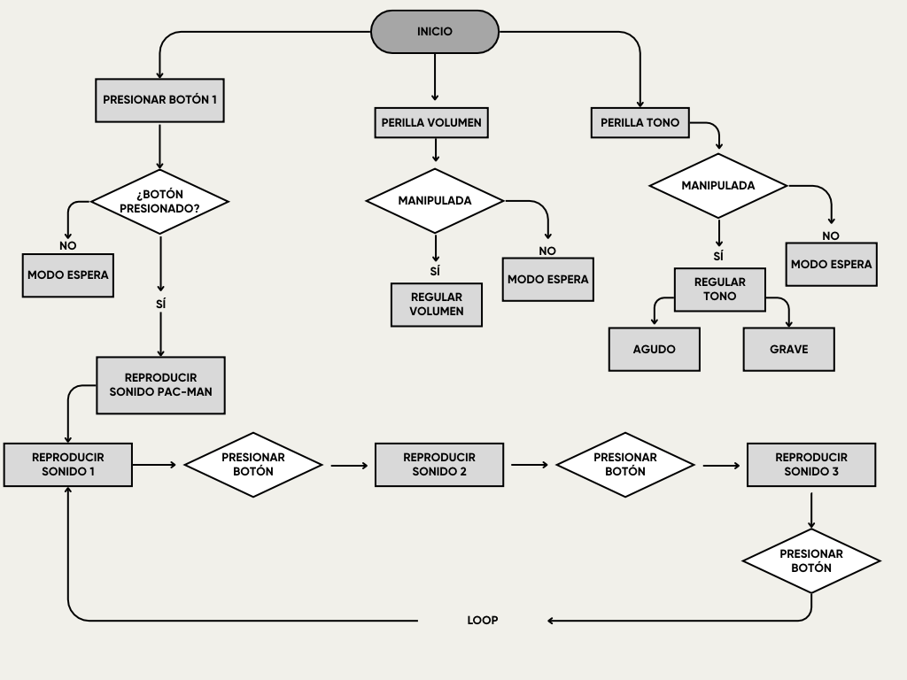

# sesion-13b

13-11-2026

## apuntes sesión

Nos dieron correcciones del proyecto e ideas sobre que, en vez de ser un *challenge*, sea más enfocado hacia un muestrario de sonidos cotidianos, a lo mejor con pájaros, taladros, sonidos de la feria, etc. También que pueda manejarse por medio de botones y que nos indiquen mediante sonidos o una pantalla, dependiendo de lo que elijamos. O podríamos dejar escrito en la carcasa cómo se utiliza, de manera sencilla y con íconos, y dejar solo los sonidos en el reproductor.

Mi idea es utilizar el parlante con 3 botones, cada uno con un título arriba que indique su tema. Al presionar cada botón, sonaría uno de los 3 sonidos distintos de ese tema, uno a la vez por cada pulsación. Habría 3 botones en total y 9 sonidos diferentes, 3 por cada tema. Si necesitamos utilizar una perilla, podría servir para variar el tono de los sonidos.

### descripción total del proyecto

La consola de sonidos retro será un muestrario interactivo que permite reconocer acciones de videojuegos a través del sonido.

Tendrá tres botones, uno para Mario, otro para Sonic y otro para Pac-Man.

Cada "juego" tendrá tres sonidos que representan lo iconico de cada uno. Así, quien la use podrá comparar cómo cada juego comunica una acción sin necesidad de mirar una pantalla.

La consola tendrá dos perillas. La primera permitirá elegir un tono más grave o más agudo. La segunda tendrá cuatro posiciones: AUTO, 1, 2 y 3. En AUTO, cada botón reproduce sus pistas en orden 1, 2, 3 y otra vez 1, con un contador independiente.

En las posiciones 1, 2 y 3 se elige directamente la pista del personaje que se pulse. Ambas perillas se pueden ajustar de antemano y sus valores se guardan al pulsar. El audio que ya está sonando conserva sus ajustes.

La consola permanece en silencio hasta que se pulsa un botón.

Cada nueva pulsación puede interrumpir la pista anterior, incluso si se vuelve a pulsar el mismo botón.

Después de una pausa breve, la pista nueva empieza desde el comienzo. Los efectos cortos podrán repetirse un número limitado de veces y, al terminar, la consola vuelve a la espera. Si los tres botones se pulsan juntos, se activa una pista sorpresa, como el ¡D’oh! de Homero Simpson.

| Posición | Acción | Mario | Sonic | Pac-Man |
|---|---|---|---|---|
| 1 | Movimiento | Salto | Spin Dash | «Waka-waka» |
| 2 | Recompensa | Moneda | Anillo | Fruta o bonificación |
| 3 | Pérdida | Pérdida de vida | Pérdida de anillos | Pérdida de vida |

### prototipos



### pseudocódigo

```
INICIO
  Iniciar en silencio y poner los tres contadores en 1

  REPETIR
    Leer perillas y detectar nuevas pulsaciones con antirrebote
    Guardar la posición del selector y el tono de cada pulsación

    SI se pulsan los tres botones dentro de la ventana del combo
      Seleccionar la pista sorpresa sin avanzar los contadores
      Rearmar el combo al soltar los tres botones
    SI NO, al cerrar la ventana
      Procesar las pulsaciones en orden
      En AUTO, seleccionar la pista del contador y avanzar 1 → 2 → 3 → 1
      En 1, 2 o 3, seleccionar esa pista sin avanzar el contador
      Si hay varias solicitudes, lanzar la última

    AL LANZAR UNA PISTA
      Cortar el audio anterior y reemplazar cualquier inicio pendiente
      Dejar 15 ms de silencio mientras se siguen leyendo los botones
      Reproducir desde el principio con el tono guardado

    AL TERMINAR UNA VUELTA
      Repetir si quedan vueltas programadas
      Si era la última, volver a la espera silenciosa
  FIN REPETIR
FIN
```

### esqueleto en wokwi

El prototipo inicial del muestrario interactivo de sonidos en wokwi:

🔗 [Ver el prototipo de la Consola en Wokwi](https://wokwi.com/projects/480948910221458433)

**Estado:** Prototipo preliminar. En el proyecto definitivo vamos a elegir un tema específico con sonidos de ese ámbito.

El proyecto aún está sujeto a cambios, pero esta es la base principal en donde vamos a trabajar.

## encargos

## lectura
